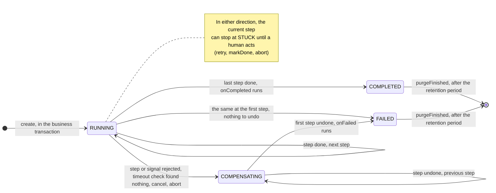
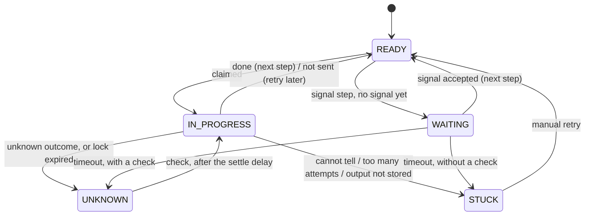

# saga-engine

A small, generic saga engine for Kotlin services that call external systems **which do not accept idempotency keys**. State lives in PostgreSQL (through Exposed), so a saga survives restarts, timeouts and crashes, and every call leaves a trace you can investigate.

- A saga is an ordered list of steps. Each step calls an external system, and can undo itself.
- The engine never calls an external system inside a database transaction.
- When the outcome of a call is unknown (timeout, connection reset, `5xx`, crash), the engine **checks** whether the call was applied before it tries again. It never replays blindly.
- When it cannot decide, it stops and waits for a human, instead of risking a duplicate.
- A saga can carry a typed **input**, fixed at creation, and each step a typed **output**, read by the steps after it: stored as JSON through kotlinx.serialization.

---

## Contents

1. [Concepts](#concepts)
2. [Installation](#installation)
3. [Writing a saga](#writing-a-saga)
4. [Running sagas](#running-sagas)
5. [What happens when things go wrong](#what-happens-when-things-go-wrong)
6. [Manual actions](#manual-actions)
7. [Operations and observability](#operations-and-observability)
8. [Configuration](#configuration)
9. [Testing your sagas](#testing-your-sagas)
10. [Known limitations](#known-limitations)

---

## Concepts

| Term | Meaning |
|---|---|
| **Saga** | One run of a definition for a business key, e.g. "set up item 42". One row in the `saga` table. |
| **Definition** | A saga type (`"ITEM_SETUP"`), its ordered steps, and two hooks: `onCompleted`, `onFailed`. |
| **Step** | One external call: `execute`, optionally `compensate` (undo) and `check` (was I applied?). |
| **Input** | What the saga was asked to do (a customer, dates…), given at creation and never changed. Optional. |
| **Output** | What a step's call returned (an id, a price…), read by the later steps, its own compensation and the hooks. Optional. |
| **Business key** | What the saga is about (an item id, an order id…). At most **one unfinished saga per key**. |
| **Compensation** | Undoing the completed steps, last to first, after a step was rejected. |

A saga has a **state**, which gives its direction or its end:

| State | Meaning |
|---|---|
| `RUNNING` | Executing steps forward |
| `COMPENSATING` | A step was rejected; undoing the completed steps |
| `COMPLETED` | Every step is done |
| `FAILED` | Every completed step was undone |

A saga's whole life, from its creation to its purge:



`RUNNING` and `COMPENSATING` are unfinished: the saga holds its business key, and `resumeDue` picks it up whenever it is due. `COMPLETED` and `FAILED` are final: nothing changes them, and a new saga may start for the same key.

Within those states, the current step has a **status**:

| Status | Meaning |
|---|---|
| `READY` | Will run at `next_attempt_at` |
| `IN_PROGRESS` | A call is in flight until `locked_until` |
| `WAITING` | A signal step waits for its signal, until its timeout at `next_attempt_at`. No call is in flight |
| `UNKNOWN` | The last call's outcome is unknown; a check is scheduled |
| `STUCK` | A human must step in |



---

## Installation

The library targets Kotlin 2.x on JVM 17+, Exposed 1.x and PostgreSQL 12+.

```kotlin
dependencies {
    implementation("com.example:saga-engine:0.1.0")
}
```

Publish it locally while it has no repository: `./gradlew publishToMavenLocal`, and add `mavenLocal()` to the consumer's repositories.

### Database schema

Copy [`src/main/resources/com/example/saga/schema.sql`](src/main/resources/com/example/saga/schema.sql) into one of your Flyway migrations (for example `V5__saga.sql`). It creates four tables:

| Table | Content |
|---|---|
| `saga` | One row per saga: state, current step, attempts, lock, last error, and its input |
| `saga_step_result` | The output of each completed step |
| `saga_signal` | The signals received for signal steps: at most one per name and saga |
| `saga_log` | History: every call, check, compensation, signal and manual action, with the trace id |

Inputs and outputs are stored as text (JSON), not JSONB: the engine never queries inside them.

---

## Writing a saga

### The step contract

```kotlin
interface SagaStep<I, O> {                                        // I: the saga's input, O: this step's output
    val name: String
    val outputType: KType?                                        // typeOf<O>(), or null for no output
    suspend fun execute(ctx: SagaContext<I>): O                    // the call; returns the step's output
    suspend fun compensate(ctx: SagaContext<I>, own: O?) {}        // undo, given its own output (default: nothing)
    suspend fun check(ctx: SagaContext<I>): CheckResult<O>         // "was I applied?" (default: CannotTell)
    fun describe(output: O): String? = null                        // what saga_log may show: an id, never personal data
}
```

`execute` reports its outcome through exceptions:

| Your code | Meaning | Engine reaction |
|---|---|---|
| returns normally | Applied | Stores the output, moves to the next step |
| throws `StepRejected` | Refused, **nothing was applied** (e.g. `400`, `422`, business refusal) | Undoes the completed steps |
| throws `StepNotSent` | The request **never left** (connection refused, DNS, connect timeout, `429`) | Retries later, with backoff |
| throws anything else | **Unknown**: it may have been applied (read timeout, reset, `5xx`) | Checks after the settle delay |

Classify errors carefully in your HTTP clients. Throwing `StepNotSent` for a request that may have reached the server can create duplicates. When in doubt, let the exception through: unknown is the safe default.

`check` answers `Done(output)` (the output found, stored as if the call had returned it), `NotDone` or `CannotTell`. Implement it with a **read** in the external system, for example "find the stock entry for this EPC". Without a `check`, an unknown outcome makes the saga stuck.

`compensate` **must be safe to run twice** ("move back to stock if it is still there", "delete if present"). The engine retries it on any error.

### Declaring a saga with the DSL

```kotlin
@Serializable data class SetupRequest(val epc: String, val storeId: String)
@Serializable data class StockEntry(val id: String, val location: String)

fun itemSetupSaga(stockClient: StockClient, bookingClient: BookingClient, items: Items) =
    saga<SetupRequest>("ITEM_SETUP") {

        val stock = step<StockEntry>("stock") {
            execute { stockClient.moveToTestStock(input.epc, input.storeId) }      // returns a StockEntry
            compensate { own -> own?.let { stockClient.revertTestStockEntry(it.id) } }  // no-op if already reverted
            checkByLookup { stockClient.findTestStockEntries(input.epc) }          // a List<StockEntry>
            logAs { it.id }                                                        // what saga_log shows
        }

        step<String>("booking") {
            execute { bookingClient.createResource(input.epc, stockId = requireResult(stock).id) }   // the resource id
            // Last step: never needs to be undone.
            checkByLookup { bookingClient.findResources(input.epc) }
        }

        onCompleted { items.markAvailable(key, location = requireResult(stock).location) }  // same transaction as the end
        onFailed { items.markSetupFailed(key) }
    }
```

Inside every block, `this` is the `SagaContext`: `key` is the business key, `input` the saga's input and `sagaId` the saga id.

| DSL | Meaning |
|---|---|
| `saga<I>(type) { … }` | Declares a saga type whose input is an `I`. `saga(type) { … }` declares one without input. Returns a `SagaDefinition` to register in the engine. |
| `step<O>(name) { … }` | Declares the next step, whose call returns an `O`; steps run in declaration order. `step(name) { … }` declares one without output. Returns a `StepRef<O>`. |
| `execute { … }` | Required. The call; returns the step's output. |
| `compensate { own -> … }` | Optional. Undo, given this step's own output. Must be safe to repeat. |
| `checkByLookup { … }` | Optional. Returns the matches found in the external system: none means not done, one means done (it becomes the step's output), several means cannot tell. |
| `check { … }` | Optional. Same as above, when you need full control: return `CheckResult.Done(output)`, `NotDone` or `CannotTell`. |
| `logAs { … }` | Optional. What `saga_log` shows about the output: an identifier, never personal data. Default: a `String` output itself, nothing for other types. |
| `input` | The saga's input, fixed at creation. |
| `result(stepRef)` / `requireResult(stepRef)` | Output of an earlier step, typed. |
| `onCompleted { … }` / `onFailed { … }` | Business effects at the end, in the saga's last transaction. |

The DSL builds plain `SagaDefinition` and `SagaStep` objects. You can also implement `SagaStep<I, O>` yourself, for example to share a step between sagas or to inject dependencies through a constructor: declare `outputType = typeOf<O>()`.

### Saga data

A saga's input and its steps' outputs are stored as text by the engine's `SagaSerializer`: JSON through kotlinx.serialization (`KotlinxJsonSagaSerializer`), so their types need `@Serializable`. The engine checks every declared type when it is built: a type it cannot serialize stops the engine at startup, not a saga in production.

- **The input is fixed at creation.** Every step, check, compensation and hook sees the request as it was made, not business data as it is when the step runs.
- **Size:** `SagaConfig.maxDataBytes`, 16 KB by default, per input and per output. Store identifiers and parameters; anything large belongs in a business table, referenced by id. An input over the limit is refused by `create`; an output over it makes the step `STUCK`, since the call has already happened.
- **Personal data:** values are stored only in `saga.input` and `saga_step_result.output`, never in `saga_log` or `last_error`, and they are deleted with the saga by `purgeFinished`.
- **Changing a type:** running sagas hold data written by the previous version of the code. The default JSON ignores unknown keys, so give added fields a default value and both versions read each other's data. For a breaking change (a field renamed, its meaning changed), declare a new saga type and keep the old one until its last saga has finished.

`onCompleted` and `onFailed` run **inside** the transaction that ends the saga, so the business state and the saga state change together. They must not call external systems.

### Waiting for a signal

A step can wait for an event that something else delivers, a payment confirmed on Kafka for example, instead of making a call. While it waits, the saga is only a row that is not due: no thread, connection or lock is held.

```kotlin
val reservation = saga<ReservationRequest>("RESERVATION") {
    val payment = step<Payment>("create-payment") {
        execute { payments.create(reference = sagaId.toString(), amount = input.amount) }   // our saga id, for routing
        compensate { own -> own?.let { payments.cancelOrRefund(it.id) } }
    }
    val paid = awaitSignal<PaymentResult>("await-payment", signal = "payment", timeout = 30.minutes) {
        onSignal { if (!it.succeeded) throw StepRejected("payment failed") }   // reject: the saga compensates
        check { payments.status(requireResult(payment).id) }                    // at the timeout: ask before giving up
        logAs { it.paymentId }
    }
    step<String>("confirm") { execute { notifications.confirmed(key, requireResult(paid).paymentId) } }
}

// One Kafka listener for every saga type: it maps events to signal names. Commit the offset once signal returns.
when (val result = engine.signal(Uuid.parse(event.reference), "payment", PaymentResult(event.paymentId, event.succeeded))) {
    is SignalResult.Delivered -> engine.run(result.sagaId, Clock.System.now() + 10.seconds)   // optional: finish now
    else -> Unit
}
```

| DSL | Meaning |
|---|---|
| `awaitSignal<S>(name, signal, timeout) { … }` | A step that makes no call and waits for the signal named `signal` (it names the event, not the step), whose value is an `S`. The value becomes the step's output. A signal name is used by one step of a saga. |
| `onSignal { value -> … }` | Optional. Throw `StepRejected` to reject the value: the saga compensates. Runs inside the engine's transaction: no external calls. |
| `check { … }` / `checkByLookup { … }` | Optional. At the timeout, ask the external system: a value found is accepted (it goes through `onSignal` too), `NotDone` rejects, `CannotTell` makes the saga stuck. Without a check, a timeout makes the saga stuck. |

`engine.signal(sagaId, name, value)` is one short transaction. The engine finds the step of that saga's definition that waits for `name`, and checks the value's type against the one it declares:

| The step for that name | Result |
|---|---|
| Is waiting | `Delivered`: accepted (the saga moves on) or rejected (it compensates) |
| Does not wait yet (an earlier step runs, or its timeout check is in flight) | `Stored`: used as soon as the step waits; during a timeout check, the check decides |
| Has already received a signal of that name, is done, or the saga finished | `Ignored`: a redelivered or late event changes nothing |
| Does not exist, or expects another type | `IllegalArgumentException`, nothing stored |
| (no saga with that id) | `NoSaga` |

The external system must carry our saga id, for example as the payment's reference, so that its events lead back to the saga. `run` returns a saga that waits with `stepStatus = WAITING`: an HTTP handler answers 202, with what earlier steps returned (`requireResult(payment).url`).

**Cancelling.** `engine.cancel(sagaId, reason, actor)` abandons a saga, a customer who cancels for example: everything done so far is compensated. A saga that waits or is ready compensates at once. One with a call in flight, or an outcome still to check, compensates as soon as that outcome is recorded, the call included. A finished saga cannot be cancelled. The saga keeps `cancel_requested_at` and the `reason` given (`cancel_reason`), which nothing overwrites, unlike `last_error`; who cancelled is in `saga_log` (`CANCEL_REQUESTED`).

---

## Running sagas

### Setup

```kotlin
val database = Database.connect(dataSource, databaseConfig = DatabaseConfig { defaultMaxAttempts = 1 })

val engine = SagaEngine(
    transactions = ExposedSagaTransactions(database),
    repository = ExposedSagaRepository(),
    definitions = listOf(itemSetupSaga(stock, booking, items)),
    serializer = KotlinxJsonSagaSerializer(),
    traceId = { Span.current().spanContext.traceId.takeIf { it != TraceId.getInvalid() } },
)
```

`defaultMaxAttempts = 1` turns off Exposed's automatic retry of failed transactions (3 attempts by default), which would hide errors. If your application already has its own transaction helper, implement `SagaTransactions` with it.

### Starting a saga from a request

Create the saga **in the same transaction** as the business change, then run it once that transaction is committed:

```kotlin
suspend fun registerItem(epc: String, storeId: String): HttpStatusCode {
    val sagaId = db.tx {
        val item = items.insert(epc, storeId)                     // status SETTING_UP
        engine.create(itemSetup, key = item.id.toString(), input = SetupRequest(epc, storeId), traceparent = currentTraceparent())
    }

    val saga = engine.run(sagaId, deadline = Clock.System.now() + 8.seconds)

    return when (saga.state) {
        SagaState.COMPLETED -> HttpStatusCode.Created              // 201
        SagaState.FAILED -> HttpStatusCode.UnprocessableEntity     // 422, reason in saga.lastError
        else -> HttpStatusCode.Accepted                            // 202: the recovery job will finish it
    }
}
```

`run` returns when the saga ends, blocks (waiting for a retry, a check or a human) or the deadline passes. The user gets an answer in seconds either way.

`create` throws `DuplicateSagaException` if an unfinished saga already exists for the key. For example, an item cannot be removed from stock while it is still being set up. Your transaction stays usable after it (the insert uses `ON CONFLICT DO NOTHING` rather than failing), so you can catch it and answer 409.

### Recovery

Call `resumeDue()` periodically, for example every 30 seconds, from your job runner or scheduler:

```kotlin
val result = engine.resumeDue(limit = 50)
result.failures.forEach { (id, e) -> logger.error("Saga $id could not be resumed", e) }
```

It picks up every saga with something to do: a retry that is due, an unknown outcome to check, a call whose lock expired. Several instances can run it at the same time, because each saga is claimed with `FOR UPDATE SKIP LOCKED`. Up to `concurrency` sagas (8 by default) run at the same time, so a slow external system does not hold up the others; keep it well below your connection pool size. A saga that throws (a database error, a bug) does not stop the others: its exception is returned in `result.failures`, and the saga is postponed by `resumeFailureDelay` (logged as `RESUME_FAILED`), so that sagas failing every time cannot fill each batch. `resumeDue` only picks up the saga types the engine knows: during a rolling deploy, pods on the old version leave new types to the new pods.

---

## What happens when things go wrong

| Situation | What the engine does |
|---|---|
| A step is **rejected** | Undoes the completed steps, last to first. The saga ends `FAILED`, then `onFailed` runs. |
| The request was **not sent** | Retries after 1, 2, 4… minutes (capped at 1 hour). After 10 attempts, `STUCK`. |
| The outcome is **unknown** | Waits for the settle delay (2 minutes), then calls `check`. `Done` stores the output found and moves on, `NotDone` executes again (after 10 attempts, `STUCK`), `CannotTell` makes the saga `STUCK`. |
| The **check fails** | Checks again later, with backoff (at least 1 minute, at most 1 hour). Failed checks are counted apart from executions. After `maxAttempts` failed checks in a row, `STUCK`, like a check that cannot tell: the call may have been applied, so look in the external system before `retry`. |
| A step throws a JVM **`Error`** (a `TODO()`, an assertion) | Treated like any failed call. Only fatal JVM errors (out of memory, stack overflow) escape. |
| The **pod dies** mid-call | The step stays `IN_PROGRESS` until its lock expires (35 s). Forward, it becomes `UNKNOWN` and is checked, never replayed blindly. During compensation it is simply replayed, since compensations are safe to repeat. |
| A **compensation fails** | Retries with backoff, then `STUCK`. The same applies when the pod keeps dying during a compensation. |
| The outcome **cannot be recorded** (`onCompleted` / `onFailed` throws, a constraint fails…) | The transaction is rolled back and recorded again, alone. If that fails too, the saga becomes `STUCK` on the step that ran, logged as `RECORD_FAILED`; a successful call's output is saved with its result. Fix the cause, then use `markDone(id, null, actor)` to continue with it (or `retry` for a compensation). |
| A call's **output cannot be stored** (it cannot be encoded, or is over `maxDataBytes`) | The call has happened, so it is never run again: the step becomes `STUCK`. Record an output with `markDone`, or undo the step with `abort(currentStepApplied = true)`. |
| **No signal before the timeout** | With a check: it decides (the value found is accepted, `NotDone` compensates, `CannotTell` makes the saga `STUCK`). Without one: `STUCK`. |
| A saga's **data cannot be read** (written by another version of the code) | No call is made. The saga is postponed by `resumeFailureDelay` and logged as `RESUME_FAILED`, so that a version that can read it picks it up. |
| A call runs **longer than `callLock`** | The engine cuts it at `callLock`: the outcome is unknown, and is checked. |
| A result arrives **after** its lock expired and another instance took over | It is ignored and logged as `LATE_RESULT_IGNORED`. |
| `resumeDue` **cannot run a saga** (database error, bug) | The error is returned in `result.failures`, and the saga is postponed by `resumeFailureDelay`. |

The settle delay matters. A request that timed out on our side may still be processed by the external system. Checking too early would find nothing, the step would run again, and you would get a duplicate. Set `settleDelay` above the longest time the external system may spend on a request.

---

## Manual actions

When a saga is `STUCK`, a human decides. List them with `engine.findStuck()` (see [Operations and observability](#operations-and-observability)): each carries a `stuckReason`, which says what to do.

| `stuckReason` | What happened | What to do |
|---|---|---|
| `CANNOT_TELL` | A check could not tell whether the step was applied (also at a signal's timeout) | Look in the external system: applied → `markDone` with the output found; not applied → `retry` |
| `CHECK_FAILING` | A check kept throwing | Same as `CANNOT_TELL`, once the lookup works again |
| `TOO_MANY_ATTEMPTS` | `maxAttempts` reached: requests not sent, re-executions, failing compensations | Fix the cause, then `retry` (or `markCompensated` for a compensation you did by hand) |
| `OUTPUT_UNSTORABLE` | The call was made, but its output could not be encoded or is over `maxDataBytes` | `markDone` with the output, or `abort` |
| `RECORD_FAILED` | The outcome could not be recorded (a hook threw…) | Fix the cause, then `markDone(id, null)`: a successful call's output is already saved |
| `NO_SIGNAL` | A signal step's timeout passed, and it has no check | Deliver the signal with `engine.signal`, then `retry`; or `abort` |

`last_error` gives the detail, and `stuckAt` when it happened. Expose these from an admin screen:

| Call | Use it when |
|---|---|
| `engine.retry(id, actor)` | The cause is fixed (service back up, data corrected). Forward, it **executes the step again without checking**: if the saga is stuck because a check could not tell, first confirm by hand that the step was not applied. |
| `engine.markDone(id, output, actor)` | You confirmed by hand that the step was applied. `output` is the step's output as JSON, checked against the step's type before it is saved; `null` keeps the output already saved (after `RECORD_FAILED`), or means no output. |
| `engine.abort(id, actor, currentStepApplied, output)` | You give up: completed steps are undone. Works on a waiting saga too. Refused while a call is in flight or its outcome is unknown. For a stuck step, look in the external system first: with `currentStepApplied = true` the stuck step is undone too, and its compensation receives `output` (JSON, checked like `markDone`'s). |
| `engine.markCompensated(id, actor)` | A compensation is stuck, and you undid the step by hand (or there was nothing to undo). The step is marked compensated and the saga goes on undoing the previous ones, or ends `FAILED`. Only for a stuck compensation. |

For a signal step that got stuck at its timeout, `retry` waits again (and uses a signal received meanwhile), and `markDone` takes the signal's value as JSON. A lost event can also be delivered by hand with `engine.signal`, and `engine.cancel` abandons a saga at any time before it finishes.

Every manual action is logged with its author in `saga_log`.

---

## Operations and observability

**Find what needs attention.** The engine has reads for an admin screen, each on an index:

| Call | Returns |
|---|---|
| `engine.findStuck(limit, types, after)` | Stuck sagas, stuck longest first, with their `stuckReason` and `stuckAt`. Next page: `after = StuckCursor.after(lastOfThePage)` |
| `engine.history(sagaId)` | Everything that happened to a saga, oldest first |
| `engine.historyByTrace(traceId)` | What one request did, from its trace id in Datadog |
| `engine.find(id)` | One saga |

The records carry the saga's encoded input, which may hold personal data: decide who may see it on the screen. The log never carries values.

**Metrics.** Two sources, for two kinds of numbers:

- **Gauges from `engine.stats()`**: unfinished sagas by state and status, stuck sagas by reason, the oldest unfinished saga (`oldestUnfinishedAt`) and how far behind the recovery job is (`now - oldestDueAt`). It reads partial indexes only; sample it about once a minute. It is always right, even after a restart.
- **Counters from a `SagaListener`**, passed to the engine: it is told about each `saga_log` entry once its transaction commits (`EXECUTE:Done`, `LOCK_EXPIRED`, `WAIT_TIMED_OUT`…), with the saga's type and state. A change that rolls back is never reported; a crash right after a commit can lose events (`saga_log` stays the record). A listener that throws is ignored. Creations are not reported: `create` runs in your transaction, whose commit the engine cannot see.

With OpenTelemetry (exported to Datadog):

```kotlin
val meter = GlobalOpenTelemetry.getMeter("saga-engine")
val events = meter.counterBuilder("saga.events").build()
val engine = SagaEngine(
    transactions, repository, definitions, KotlinxJsonSagaSerializer(),
    listeners = listOf(SagaListener { e ->
        events.add(1, Attributes.of(stringKey("saga.type"), e.sagaType, stringKey("saga.event"), e.entry.event))
    }),
)

val latest = AtomicReference<SagaStats?>(null)       // a gauge callback cannot suspend: sample in a ticker
scope.launch { while (isActive) { latest.set(runCatching { engine.stats() }.getOrNull()); delay(60.seconds) } }
meter.gaugeBuilder("saga.stuck").ofLongs().buildWithCallback { m ->
    latest.get()?.stuckByReason?.forEach { (reason, n) -> m.record(n, Attributes.of(stringKey("reason"), reason.name)) }
}
```

Keep attributes low in cardinality (type, event, reason), never a saga id or a key. Every pod reports the same gauges: aggregate them with `max`, not `sum`.

**Tracing.** Pass a `traceId` provider to the engine. Every `saga_log` line then carries the OpenTelemetry trace id of the call, so you can open the matching trace in Datadog from a database row. The engine reads it on the caller's coroutine (in `create`, `run` and the manual actions), before switching to the transaction dispatcher, so the coroutine must carry the OpenTelemetry context (for example with `Context.current().asContextElement()` from `opentelemetry-extension-kotlin`). Runs started by `resumeDue` carry whatever trace the job runner has. The `traceparent` of the request that started the saga is stored on the saga, so you can link recovery runs back to that request.

`saga_log` is the durable record of every exchange. That matters when application logs only live as long as the pod.

**Suggested alerts** (thresholds to tune):

| Alert | From | Threshold |
|---|---|---|
| Stuck sagas | `stats().stuckByReason` | > 0 for 5 minutes |
| Recovery job behind | `now - stats().oldestDueAt` | > 5 minutes |
| Old unfinished sagas | `now - stats().oldestUnfinishedAt` | above the longest signal timeout, plus an hour |
| Sagas that cannot be read | `RESUME_FAILED` events | more than a few per 10 minutes |
| Pods dying mid-call | `LOCK_EXPIRED` events | a rise against the usual rate |

**Retention.** History grows by about 1.5 KB per saga, plus the size of its input and outputs. Keep one month by calling `purgeFinished` from the job runner, for example once a day:

```kotlin
engine.purgeFinished(olderThan = 30.days)
```

It deletes the sagas that finished (`COMPLETED` or `FAILED`) more than 30 days ago, with their results and log, in batches of 1,000 (one short transaction each). Unfinished and stuck sagas are never deleted, however old. Export what you need beforehand if you must keep history longer (audit, reconciliation).

---

## Configuration

```kotlin
SagaConfig(
    callLock = 35.seconds,        // HTTP timeout + margin
    settleDelay = 2.minutes,      // > max processing time of the external systems
    checkRetryDelay = 1.minutes,
    maxAttempts = 10,
    maxBackoff = 1.hours,
    resumeFailureDelay = 1.minutes,    // after resumeDue could not run a saga
)
```

`callLock` must be longer than your HTTP client timeout. The engine cuts any call at `callLock` (its outcome is then unknown, and checked), but a client timeout just below it gives clearer errors.

The engine compares lock expiry times written by different instances, so their clocks must agree (NTP): a drift of a few seconds is harmless next to `callLock`. `ExposedSagaTransactions` always uses READ COMMITTED, whatever your application's default: the row locking relies on it.

---

## Testing your sagas

`InMemorySagaRepository` and `InMemorySagaTransactions` run the engine without a database. Combine them with a controllable `kotlin.time.Clock` to test every path of your steps:

```kotlin
val repository = InMemorySagaRepository()
val itemSetup = itemSetupSaga(fakeStock, fakeBooking, fakeItems)
val engine = SagaEngine(InMemorySagaTransactions(repository), repository, listOf(itemSetup), KotlinxJsonSagaSerializer(), clock = clock)

val id = engine.create(itemSetup, "item-1", SetupRequest(epc = "E-1", storeId = "S-1"))
engine.run(id, clock.now() + 10.seconds)
clock.advance(2.minutes)
engine.resumeDue()

assertEquals(SagaState.COMPLETED, repository.find(id)!!.state)
```

`SagaEngineTest` covers the engine itself, `SagaDslTest` the DSL. `ExposedSagaRepositoryIT` runs it against PostgreSQL with Testcontainers, so it needs Docker.

```bash
./gradlew test
```

### Stress test and benchmark

Two longer checks run against PostgreSQL in Docker. They are left out of `./gradlew test`.

```bash
./gradlew stressTest                                   # about 20 s
./gradlew stressTest -Dsaga.sagas=1000 -Dsaga.pods=5 -Dsaga.seed=42
./gradlew benchmark                                    # about 40 s, report in build/reports/saga-benchmark.md
./gradlew benchmark -Dsaga.sagas=2000 -Dsaga.concurrency=16
```

**`SagaStressIT`** runs hundreds of sagas while failures are injected at random, and checks every invariant at the end:
- **Injected failures:** rejections, requests not sent, lost requests and lost responses, calls that outlive their lock, failing or undecided checks, failing compensations, hooks that throw after writing, and pods dying mid-call. Payment sagas wait for the provider's event, which arrives early, late (after the timeout), twice or never, and customers cancel sagas at random moments.
- **Concurrent actors:** several pods resume sagas, a Kafka listener delivers payment events, and an operator pages through `findStuck` and resolves stuck sagas from what the external systems really hold.
- **Ground truth:** the simulated external systems record what was really applied.
- **Invariants checked:**
  - every saga ends;
  - nothing is ever applied twice;
  - a completed saga matches the external systems exactly;
  - a failed saga left nothing behind;
  - each hook ran exactly once;
  - each step saw the right output from the previous one, and every external effect was made with the saga's input;
  - every stored output equals what the external system returned;
  - a completed payment saga holds the provider's payment, which succeeded;
  - a cancelled saga always ends failed, compensated;
  - every stuck saga has a reason;
  - the listeners were told only what `saga_log` holds, at most once, and never a value;
  - no input or output value ever appears in `saga_log` or `last_error`.

Concurrency makes runs non-deterministic: a seed reproduces the mix of failures, not the exact interleaving. A run that fails prints its seed and the violations.

**`SagaBenchmarkIT`** measures the engine's own cost, with steps that return immediately. It covers three scenarios: requests one after another, concurrent requests, and recovery through `resumeDue`. For each it reports latency, statements and transactions per saga (from `pg_stat_statements`), and table sizes.

---

## Known limitations

These are behaviours of the current code to design around. Each one says what happens and what to do about it.

### Duplicates are rarer, not impossible

The engine never replays a call blindly, but a duplicate can still happen in these cases:

- **The external system applies a request late,** after `settleDelay`. The check finds nothing, the step runs again, and the late request lands too. Set `settleDelay` above the longest time the system may spend on a request, make the system refuse duplicates where you can (a unique EPC), and reconcile periodically.
- **The lookup lags.** If the external system's search is eventually consistent, a check can answer "not done" for a call that was applied. A `check` must read from a source that already shows what was written.
- **A step classifies an error wrongly.** Throwing `StepNotSent` for a request that may have left skips the check. When in doubt, let the exception through: unknown is the safe default.
- **An operator runs `retry` on a step that was applied.** `retry` executes again without checking. Look in the external system first.

### Calls must be cancellable

The engine cuts each call shortly before its lock expires, by cancelling its coroutine. That only stops code that suspends: a **blocking** call (a JDBC query, `java.net.http.HttpClient.send`, `Thread.sleep`) runs to its end, and can still outlive its lock. Another instance may then check the step, or run a compensation again, while the call is still in flight. Use a suspending client (for example Ktor's), wrap blocking code in `runInterruptible`, and give every client its own timeout below `callLock`.

### Compensations can run more than once

A compensation runs again after any error, after its lock expired, and after a manual `retry`. It must be safe to repeat ("delete if present", "move back if still there"). If a stuck compensation was done by hand, `markCompensated` records it; `retry` would run it again, which works only because it is safe to repeat.

### No isolation

Other systems and users see the intermediate state while a saga runs (stock moved, resource not yet created), and while it compensates. Business rules that must not see it need their own status, for example the item's `SETTING_UP`.

### Timing

- **The time budget of `run` is checked between calls, not during them.** An HTTP request that runs a saga inline can wait up to the budget plus one call (at most `callLock`) before it gets its answer.
- **An unknown outcome takes at least `settleDelay`** (2 minutes) to resolve, since the check must wait for it. The caller gets a 202 meanwhile.
- **No timeout on a whole saga.** Backoff can wait up to `maxBackoff` (1 hour) between attempts, and a step whose check keeps failing becomes `STUCK` only after about 4 hours with the defaults. Watch for old unfinished sagas, not only stuck ones.
- **The clocks of the instances must agree** (NTP). Lock expiry compares times written by different instances: a drift of a few seconds is harmless next to `callLock`.

### Data and definitions

- **Steps run one after the other.** No parallel branches.
- **One signal per name and saga.** A saga that needs two payments (a deposit, then the balance) waits for two names. A signal must carry our saga id to be routed: for a system that only returns its own ids, a correlation table would be needed, not built yet.
- **Saga data is for parameters and identifiers,** at most `maxDataBytes` (16 KB) per value. An input up to about 2 KB is stored inside the saga row, which the engine updates about 4 times per saga: each update copies it, so it takes several times its size until PostgreSQL vacuums the old copies. Moving the input to a table written once is proposed.
- **Data written by one version of the code must stay readable by the next.** Add fields with defaults; for anything else, declare a new saga type.
- **Renaming or reordering steps** affects running sagas, which store the index and name of their current step. Let them finish, or migrate them, before changing a definition.
- **Removing a saga type** leaves its unfinished sagas untouched for ever: `resumeDue` skips unknown types, manual actions fail on them, and their business keys stay blocked for new sagas. Finish or migrate them before removing the type.
- **`onCompleted` and `onFailed` run inside the engine's transaction.** They must be quick and must not call external systems. One that throws makes the saga `STUCK` (`RECORD_FAILED`) after one more attempt.

### Operations

- **No admin screen or HTTP API in the library:** it gives the reads (`findStuck`, `history`, `stats`) and the actions; the application exposes them, with its own authentication.
- **Listener events are at most once.** A crash, or a connection lost right after a commit, loses the events of that transaction. Counters can drift slightly; gauges from `stats()` do not.
- **A database outage postpones a whole `resumeDue` batch** by `resumeFailureDelay` (1 minute): each saga that failed to run waits that long before the next try.
- **`resumeDue` holds up to `concurrency` connections at once** during their short transactions. Keep it well below the connection pool size.
- **Retention deletes history for good.** `purgeFinished` removes finished sagas with their results and log. Export what you must keep longer.
- **Fatal JVM errors** (out of memory, stack overflow) are never caught. The step stays `IN_PROGRESS` until its lock expires, then is checked.

### Storage

- **PostgreSQL only.** The Exposed repository uses `FOR UPDATE SKIP LOCKED`, `ON CONFLICT DO NOTHING` and partial indexes, and its transactions always run in READ COMMITTED. Another database needs its own `SagaRepository`.
- **The in-memory repository is for tests only.** Build `InMemorySagaTransactions(repository)` on the same repository, so failed transactions are rolled back as in PostgreSQL.
