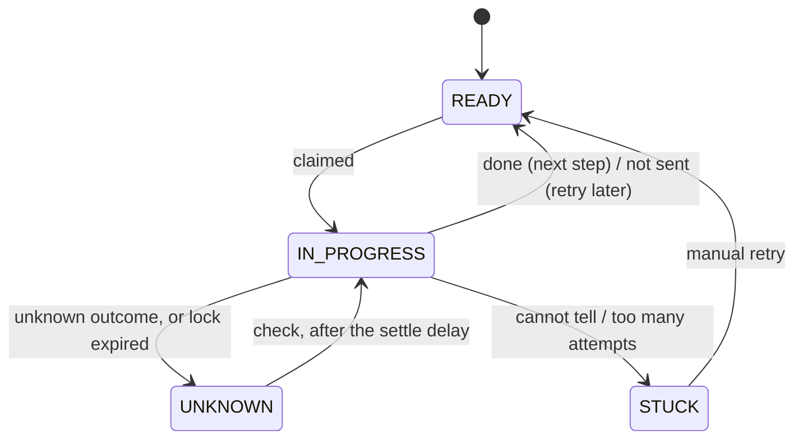

# saga-engine

A small, generic saga engine for Kotlin services that call external systems **which do not accept idempotency keys**. State lives in PostgreSQL (through Exposed), so a saga survives restarts, timeouts and crashes, and every call leaves a trace you can investigate.

- A saga is an ordered list of steps. Each step calls an external system, and can undo itself.
- The engine never calls an external system inside a database transaction.
- When the outcome of a call is unknown (timeout, connection reset, `5xx`, crash), the engine **checks** whether the call was applied before it tries again. It never replays blindly.
- When it cannot decide, it stops and waits for a human, instead of risking a duplicate.

---

## Contents

1. [Concepts](#concepts)
2. [Installation](#installation)
3. [Writing a saga](#writing-a-saga)
4. [Running sagas](#running-sagas)
5. [What happens when things go wrong](#what-happens-when-things-go-wrong)
6. [Manual actions](#manual-actions)
7. [Operations and observability](#operations-and-observability)
8. [Configuration](#configuration)
9. [Testing your sagas](#testing-your-sagas)
10. [Limits](#limits)

---

## Concepts

| Term | Meaning |
|---|---|
| **Saga** | One run of a definition for a business key, e.g. "set up item 42". One row in the `saga` table. |
| **Definition** | A saga type (`"ITEM_SETUP"`), its ordered steps, and two hooks: `onCompleted`, `onFailed`. |
| **Step** | One external call: `execute`, optionally `compensate` (undo) and `check` (was I applied?). |
| **Business key** | What the saga is about (an item id, an order id…). At most **one unfinished saga per key**. |
| **Compensation** | Undoing the completed steps, last to first, after a step was rejected. |

A saga has a **state**, which gives its direction or its end:

| State | Meaning |
|---|---|
| `RUNNING` | Executing steps forward |
| `COMPENSATING` | A step was rejected; undoing the completed steps |
| `COMPLETED` | Every step is done |
| `FAILED` | Every completed step was undone |

The current step has a **status**:

| Status | Meaning |
|---|---|
| `READY` | Will run at `next_attempt_at` |
| `IN_PROGRESS` | A call is in flight until `locked_until` |
| `UNKNOWN` | The last call's outcome is unknown; a check is scheduled |
| `STUCK` | A human must step in |



---

## Installation

The library targets Kotlin 2.x on JVM 17+, Exposed 1.x and PostgreSQL 12+.

```kotlin
dependencies {
    implementation("com.example:saga-engine:0.1.0")
}
```

Publish it locally while it has no repository: `./gradlew publishToMavenLocal`, and add `mavenLocal()` to the consumer's repositories.

### Database schema

Copy [`src/main/resources/com/example/saga/schema.sql`](src/main/resources/com/example/saga/schema.sql) into one of your Flyway migrations (for example `V5__saga.sql`). It creates three tables:

| Table | Content |
|---|---|
| `saga` | One row per saga: state, current step, attempts, lock, last error |
| `saga_step_result` | The external reference returned by each completed step |
| `saga_log` | History: every call, check, compensation and manual action, with the trace id |

There is no JSONB: a step finds its input from the business key and from earlier results.

If you already applied an earlier version of the schema, add what it lacks in a new migration (the column holds the count of failed checks, the index serves `purgeFinished`):

```sql
ALTER TABLE saga ADD COLUMN check_failures int NOT NULL DEFAULT 0 CHECK (check_failures >= 0);
CREATE INDEX saga_finished ON saga (updated_at) WHERE state IN ('COMPLETED', 'FAILED');
```

---

## Writing a saga

### The step contract

```kotlin
interface SagaStep {
    val name: String
    suspend fun execute(ctx: SagaContext): String?             // the call; returns a reference to keep
    suspend fun compensate(ctx: SagaContext) {}                 // undo (default: nothing)
    suspend fun check(ctx: SagaContext): CheckResult            // "was I applied?" (default: CannotTell)
}
```

`execute` reports its outcome through exceptions:

| Your code | Meaning | Engine reaction |
|---|---|---|
| returns normally | Applied | Stores the reference, moves to the next step |
| throws `StepRejected` | Refused, **nothing was applied** (e.g. `400`, `422`, business refusal) | Undoes the completed steps |
| throws `StepNotSent` | The request **never left** (connection refused, DNS, connect timeout, `429`) | Retries later, with backoff |
| throws anything else | **Unknown**: it may have been applied (read timeout, reset, `5xx`) | Checks after the settle delay |

Classify errors carefully in your HTTP clients. Throwing `StepNotSent` for a request that may have reached the server can create duplicates. When in doubt, let the exception through: unknown is the safe default.

`check` answers `Done(ref)`, `NotDone` or `CannotTell`. Implement it with a **read** in the external system, for example "find the stock entry for this EPC". Without a `check`, an unknown outcome makes the saga stuck.

`compensate` **must be safe to run twice** ("move back to stock if it is still there", "delete if present"). The engine retries it on any error.

### Declaring a saga with the DSL

```kotlin
fun itemSetupSaga(stockClient: StockClient, bookingClient: BookingClient, items: Items) = saga("ITEM_SETUP") {

    val stock = step("stock") {
        execute { stockClient.moveToTestStock(items.epcOf(key)) }             // returns the stock id
        compensate { stockId -> stockClient.revertTestStockEntry(stockId!!) }  // no-op if already reverted
        checkByLookup { stockClient.findTestStockEntries(items.epcOf(key)) }
    }

    step("booking") {
        execute { bookingClient.createResource(items.epcOf(key), stockId = requireResult(stock)) }
        // Last step: never needs to be undone.
        checkByLookup { bookingClient.findResources(items.epcOf(key)) }
    }

    onCompleted { items.markAvailable(key) }      // same transaction as the end of the saga
    onFailed { items.markSetupFailed(key) }
}
```

Inside every block, `this` is the `SagaContext`: `key` is the business key and `sagaId` the saga id.

| DSL | Meaning |
|---|---|
| `saga(type) { … }` | Declares a saga type. Returns a `SagaDefinition` to register in the engine. |
| `step(name) { … }` | Declares the next step; steps run in declaration order. Returns a `StepRef`. |
| `execute { … }` | Required. The call; returns the reference to keep, or null. |
| `compensate { ownResult -> … }` | Optional. Undo, given the reference this step returned. Must be safe to repeat. |
| `checkByLookup { … }` | Optional. Returns the matches found in the external system: none means not done, one means done (its reference is kept), several means cannot tell. |
| `check { … }` | Optional. Same as above, when you need full control: return `CheckResult.Done(ref)`, `NotDone` or `CannotTell`. |
| `result(stepRef)` / `requireResult(stepRef)` | Reference returned by an earlier step. |
| `onCompleted { … }` / `onFailed { … }` | Business effects at the end, in the saga's last transaction. |

The DSL builds plain `SagaDefinition` and `SagaStep` objects. You can also implement `SagaStep` yourself, for example to share a step between sagas or to inject dependencies through a constructor.

`onCompleted` and `onFailed` run **inside** the transaction that ends the saga, so the business state and the saga state change together. They must not call external systems.

---

## Running sagas

### Setup

```kotlin
val database = Database.connect(dataSource, databaseConfig = DatabaseConfig { defaultMaxAttempts = 1 })

val engine = SagaEngine(
    transactions = ExposedSagaTransactions(database),
    repository = ExposedSagaRepository(),
    definitions = listOf(itemSetupSaga(stock, booking, items)),
    traceId = { Span.current().spanContext.traceId.takeIf { it != TraceId.getInvalid() } },
)
```

`defaultMaxAttempts = 1` turns off Exposed's automatic retry of failed transactions (3 attempts by default), which would hide errors. If your application already has its own transaction helper, implement `SagaTransactions` with it.

### Starting a saga from a request

Create the saga **in the same transaction** as the business change, then run it once that transaction is committed:

```kotlin
suspend fun registerItem(epc: String, storeId: String): HttpStatusCode {
    val sagaId = db.tx {
        val item = items.insert(epc, storeId)                     // status SETTING_UP
        engine.create("ITEM_SETUP", item.id.toString(), traceparent = currentTraceparent())
    }

    val saga = engine.run(sagaId, deadline = Clock.System.now() + 8.seconds)

    return when (saga.state) {
        SagaState.COMPLETED -> HttpStatusCode.Created              // 201
        SagaState.FAILED -> HttpStatusCode.UnprocessableEntity     // 422, reason in saga.lastError
        else -> HttpStatusCode.Accepted                            // 202: the recovery job will finish it
    }
}
```

`run` returns when the saga ends, blocks (waiting for a retry, a check or a human) or the deadline passes. The user gets an answer in seconds either way.

`create` throws `DuplicateSagaException` if an unfinished saga already exists for the key. For example, an item cannot be removed from stock while it is still being set up. Your transaction stays usable after it (the insert uses `ON CONFLICT DO NOTHING` rather than failing), so you can catch it and answer 409.

### Recovery

Call `resumeDue()` periodically, for example every 30 seconds, from your job runner or scheduler:

```kotlin
val result = engine.resumeDue(limit = 50)
result.failures.forEach { (id, e) -> logger.error("Saga $id could not be resumed", e) }
```

It picks up every saga with something to do: a retry that is due, an unknown outcome to check, a call whose lock expired. Several instances can run it at the same time, because each saga is claimed with `FOR UPDATE SKIP LOCKED`. Up to `concurrency` sagas (8 by default) run at the same time, so a slow external system does not hold up the others; keep it well below your connection pool size. A saga that throws (a database error, a bug) does not stop the others: its exception is returned in `result.failures`, and the saga is postponed by `resumeFailureDelay` (logged as `RESUME_FAILED`), so that sagas failing every time cannot fill each batch. `resumeDue` only picks up the saga types the engine knows: during a rolling deploy, pods on the old version leave new types to the new pods.

---

## What happens when things go wrong

| Situation | What the engine does |
|---|---|
| A step is **rejected** | Undoes the completed steps, last to first. The saga ends `FAILED`, then `onFailed` runs. |
| The request was **not sent** | Retries after 1, 2, 4… minutes (capped at 1 hour). After 10 attempts, `STUCK`. |
| The outcome is **unknown** | Waits for the settle delay (2 minutes), then calls `check`. `Done` keeps the reference and moves on, `NotDone` executes again (after 10 attempts, `STUCK`), `CannotTell` makes the saga `STUCK`. |
| The **check fails** | Checks again later, with backoff (at least 1 minute, at most 1 hour). Failed checks are counted apart from executions. After `maxAttempts` failed checks in a row, `STUCK`, like a check that cannot tell: the call may have been applied, so look in the external system before `retry`. |
| A step throws a JVM **`Error`** (a `TODO()`, an assertion) | Treated like any failed call. Only fatal JVM errors (out of memory, stack overflow) escape. |
| The **pod dies** mid-call | The step stays `IN_PROGRESS` until its lock expires (35 s). Forward, it becomes `UNKNOWN` and is checked, never replayed blindly. During compensation it is simply replayed, since compensations are safe to repeat. |
| A **compensation fails** | Retries with backoff, then `STUCK`. The same applies when the pod keeps dying during a compensation. |
| The outcome **cannot be recorded** (`onCompleted` / `onFailed` throws, a constraint fails…) | The transaction is rolled back and the saga becomes `STUCK` on the step that ran. The outcome, including its reference, is kept in `last_error` and logged as `RECORD_FAILED`. Fix the cause, then use `markDone(id, ref, actor)` (or `retry` for a compensation). |
| A call runs **longer than `callLock`** | The engine cuts it at `callLock`: the outcome is unknown, and is checked. |
| A result arrives **after** its lock expired and another instance took over | It is ignored and logged as `LATE_RESULT_IGNORED`. |
| `resumeDue` **cannot run a saga** (database error, bug) | The error is returned in `result.failures`, and the saga is postponed by `resumeFailureDelay`. |

The settle delay matters. A request that timed out on our side may still be processed by the external system. Checking too early would find nothing, the step would run again, and you would get a duplicate. Set `settleDelay` above the longest time the external system may spend on a request.

---

## Manual actions

When a saga is `STUCK`, a human decides. Expose these from an admin screen:

| Call | Use it when |
|---|---|
| `engine.retry(id, actor)` | The cause is fixed (service back up, data corrected). Forward, it **executes the step again without checking**: if the saga is stuck because a check could not tell, first confirm by hand that the step was not applied. |
| `engine.markDone(id, ref, actor)` | You confirmed by hand that the step was applied, and you have its reference |
| `engine.abort(id, actor, currentStepApplied, ref)` | You give up: completed steps are undone. Refused while a call is in flight or its outcome is unknown. For a stuck step, look in the external system first: with `currentStepApplied = true` the stuck step is undone too, and its compensation receives `ref`. |

Every manual action is logged with its author in `saga_log`.

---

## Operations and observability

**Find what needs attention:**

```sql
-- Stuck sagas
SELECT id, type, business_key, step_index, last_error, updated_at
FROM saga WHERE step_status = 'STUCK' ORDER BY updated_at;

-- Sagas running for more than 30 minutes
SELECT id, type, business_key, state, step_status, last_error
FROM saga WHERE state IN ('RUNNING', 'COMPENSATING') AND created_at < now() - interval '30 minutes';

-- Full history of one business key
SELECT l.at, s.type, l.step_name, l.event, l.detail, l.actor, l.trace_id
FROM saga_log l JOIN saga s ON s.id = l.saga_id
WHERE s.business_key = :key ORDER BY l.at;
```

**Tracing.** Pass a `traceId` provider to the engine. Every `saga_log` line then carries the OpenTelemetry trace id of the call, so you can open the matching trace in Datadog from a database row. The engine reads it on the caller's coroutine (in `create`, `run` and the manual actions), before switching to the transaction dispatcher, so the coroutine must carry the OpenTelemetry context (for example with `Context.current().asContextElement()` from `opentelemetry-extension-kotlin`). Runs started by `resumeDue` carry whatever trace the job runner has. The `traceparent` of the request that started the saga is stored on the saga, so you can link recovery runs back to that request.

`saga_log` is the durable record of every exchange. That matters when application logs only live as long as the pod.

**Suggested alerts:**
- `count(*) WHERE step_status = 'STUCK' > 0`
- oldest unfinished saga older than 30 minutes
- rate of `EXECUTE:Unknown` events per step

**Retention.** History grows by about 1.5 KB per saga. Keep one month by calling `purgeFinished` from the job runner, for example once a day:

```kotlin
engine.purgeFinished(olderThan = 30.days)
```

It deletes the sagas that finished (`COMPLETED` or `FAILED`) more than 30 days ago, with their results and log, in batches of 1,000 (one short transaction each). Unfinished and stuck sagas are never deleted, however old. Export what you need beforehand if you must keep history longer (audit, reconciliation).

---

## Configuration

```kotlin
SagaConfig(
    callLock = 35.seconds,        // HTTP timeout + margin
    settleDelay = 2.minutes,      // > max processing time of the external systems
    checkRetryDelay = 1.minutes,
    maxAttempts = 10,
    maxBackoff = 1.hours,
    resumeFailureDelay = 1.minutes,    // after resumeDue could not run a saga
)
```

`callLock` must be longer than your HTTP client timeout. The engine cuts any call at `callLock` (its outcome is then unknown, and checked), but a client timeout just below it gives clearer errors.

The engine compares lock expiry times written by different instances, so their clocks must agree (NTP): a drift of a few seconds is harmless next to `callLock`. `ExposedSagaTransactions` always uses READ COMMITTED, whatever your application's default: the row locking relies on it.

---

## Testing your sagas

`InMemorySagaRepository` and `InMemorySagaTransactions` run the engine without a database. Combine them with a controllable `kotlin.time.Clock` to test every path of your steps:

```kotlin
val repository = InMemorySagaRepository()
val engine = SagaEngine(InMemorySagaTransactions(repository), repository, listOf(itemSetupSaga(fakeStock, fakeBooking, fakeItems)), clock = clock)

val id = engine.create("ITEM_SETUP", "item-1")
engine.run(id, clock.now() + 10.seconds)
clock.advance(2.minutes)
engine.resumeDue()

assertEquals(SagaState.COMPLETED, repository.find(id)!!.state)
```

`SagaEngineTest` covers the engine itself, `SagaDslTest` the DSL. `ExposedSagaRepositoryIT` runs it against PostgreSQL with Testcontainers, so it needs Docker.

```bash
./gradlew test
```

### Stress test and benchmark

Two longer checks run against PostgreSQL in Docker. They are left out of `./gradlew test`.

```bash
./gradlew stressTest                                   # about 20 s
./gradlew stressTest -Dsaga.sagas=1000 -Dsaga.pods=5 -Dsaga.seed=42
./gradlew benchmark                                    # about 40 s, report in build/reports/saga-benchmark.md
./gradlew benchmark -Dsaga.sagas=2000 -Dsaga.concurrency=16
```

**`SagaStressIT`** runs hundreds of sagas while failures are injected at random, and checks every invariant at the end:
- **Injected failures:** rejections, requests not sent, lost requests and lost responses, calls that outlive their lock, failing or undecided checks, failing compensations, hooks that throw after writing, and pods dying mid-call.
- **Concurrent actors:** several pods resume sagas while an operator resolves stuck sagas from what the external systems really hold.
- **Ground truth:** the simulated external systems record what was really applied.
- **Invariants checked:**
  - every saga ends;
  - nothing is ever applied twice;
  - a completed saga matches the external systems exactly;
  - a failed saga left nothing behind;
  - each hook ran exactly once;
  - each step saw the right reference from the previous one.

Concurrency makes runs non-deterministic: a seed reproduces the mix of failures, not the exact interleaving. A run that fails prints its seed and the violations.

**`SagaBenchmarkIT`** measures the engine's own cost, with steps that return immediately. It covers three scenarios: requests one after another, concurrent requests, and recovery through `resumeDue`. For each it reports latency, statements and transactions per saga (from `pg_stat_statements`), and table sizes.

---

## Limits

- **Steps run one after the other.** No parallel steps.
- **No timeout on a whole saga.** A saga waits as long as it takes; watch `STUCK` and old sagas.
- **Duplicates are still possible** if an external system processes a request after the settle delay. Make external systems refuse duplicates where you can (for example a unique EPC), and reconcile periodically.
- **Renaming or reordering steps** affects running sagas, which store the index and name of their current step. Let running sagas finish, or migrate them, before changing a definition.
- **The in-memory repository is for tests only.** Build `InMemorySagaTransactions(repository)` on the same repository, so failed transactions are rolled back as in PostgreSQL.
