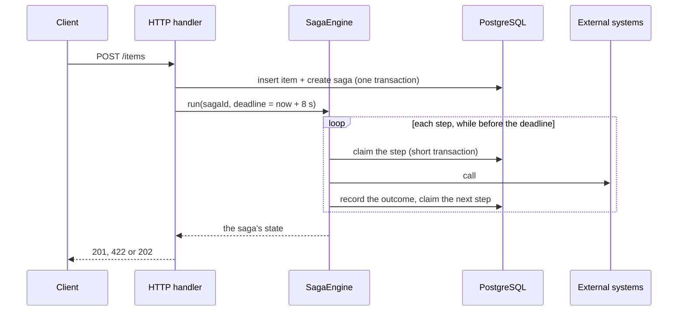

# Running sagas

A saga is started from the request that needs it, runs inline for a few seconds, and is finished by a recovery job if it needs longer. Both use the same engine.

## Start it from a request

Create the saga **in the same transaction** as the business change, then run it once that transaction has committed:

```kotlin
suspend fun registerItem(epc: String, storeId: String): HttpStatusCode {
    val sagaId = db.tx {
        val item = items.insert(epc, storeId)                     // status SETTING_UP
        engine.create(itemSetup, key = item.id.toString(), input = SetupRequest(epc, storeId))
    }

    val saga = engine.run(sagaId, deadline = Clock.System.now() + 8.seconds)

    return when (saga.state) {
        SagaState.COMPLETED -> HttpStatusCode.Created              // 201: done
        SagaState.FAILED -> HttpStatusCode.UnprocessableEntity     // 422: refused, reason in saga.failureReason
        else -> HttpStatusCode.Accepted                            // 202: the recovery job finishes it
    }
}
```

- **`create`** writes the saga row in your transaction: either the item and its saga both exist, or neither does. Nothing is called yet.
- **`run`** moves the saga forward until it ends, blocks (a retry later, an outcome to check, a human), or the deadline passes. The deadline is checked between calls: the answer comes within the deadline plus one call at most.
- **The business key** (`key`) says what the saga is about. At most one unfinished saga per key: `create` throws `DuplicateSagaException` otherwise, for example when an item is removed while it is still being set up. Your transaction stays usable after it, so you can answer 409.



## Finish it with a recovery job

Call `resumeDue` periodically, every 30 seconds for example, from your job runner or scheduler:

```kotlin
val result = engine.resumeDue(limit = 50)
result.failures.forEach { (id, e) -> logger.error("Saga $id could not be resumed", e) }
```

It picks up every saga with something to do: a retry that is due, an outcome to check, a call whose pod died, a signal's timeout. It is safe on several pods at once: each saga is claimed with `FOR UPDATE SKIP LOCKED`, so two pods never run the same saga. See [Recovery and concurrency](../how-it-works/recovery.md).

## Clean up finished sagas

Finished sagas are kept for investigation, then deleted. Call this once a day:

```kotlin
engine.purgeFinished(olderThan = 30.days)
```

It deletes sagas that finished more than 30 days ago with their results, signals and history, in batches of 1,000. Unfinished and stuck sagas are never deleted.

Next: [test it](testing.md).
