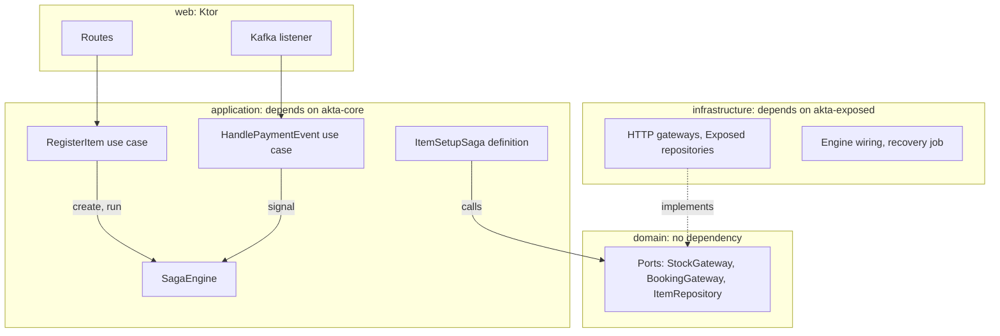

# Clean architecture with Ktor

A saga is **application-level orchestration**: it decides which ports are called, in what order, and what undoes what. So its definition lives in the application layer, next to the use cases, and calls ports only. A use case does not contain the saga: it **starts** it.



## Modules and dependencies

| Module | Contains | Depends on |
|---|---|---|
| `domain` | Entities, ports (gateways to external systems, repositories), domain errors | nothing |
| `application` | Use cases, saga definitions, a `UnitOfWork` port | `domain`, **`akta-core`** |
| `infrastructure` | HTTP gateways, Exposed repositories, the engine's wiring, the recovery job | `application`, **`akta-exposed`** |
| `web` (or `app`) | Ktor routes, listeners, the composition root | everything |

`akta-core` has no database dependency: the application layer sees the engine, the DSL and the model, never Exposed. Only infrastructure depends on `akta-exposed`.

```kotlin title="application/build.gradle.kts"
dependencies {
    implementation(project(":domain"))
    implementation("dev.octogene:akta-core:0.1.0")
}
```

```kotlin title="infrastructure/build.gradle.kts"
dependencies {
    implementation(project(":application"))
    implementation("dev.octogene:akta-exposed:0.1.0")
}
```

## Domain: ports that speak the domain's language

```kotlin
interface StockGateway {
    suspend fun moveToTestStock(epc: String, storeId: String): StockEntry
    suspend fun revert(entryId: String)
    suspend fun findEntries(epc: String): List<StockEntry>
}

// What a gateway can say when a call does not work.
class Refused(reason: String) : Exception(reason)            // the system said no: nothing applied
class Unreachable(cause: Throwable) : Exception(cause)       // the request never left
```

The adapter decides what these mean for its API: a `4xx` is `Refused`; a connection refused or a `429` is `Unreachable`. Anything it is not sure about, a read timeout or a `5xx`, it lets through as any other exception: **unknown is the safe default**.

## Application: the saga definition

A class with its ports injected, built once at startup. The engine needs every definition when it is built.

```kotlin
class ItemSetupSaga(stock: StockGateway, booking: BookingGateway, items: ItemRepository) {
    val definition = saga<SetupRequest>("ITEM_SETUP") {
        val entry = step<StockEntry>("stock") {
            execute { classified { stock.moveToTestStock(input.epc, input.storeId) } }
            compensate { own -> own?.let { stock.revert(it.id) } }
            checkByLookup { stock.findEntries(input.epc) }
            logAs { it.id }
        }
        step<String>("booking") {
            execute { classified { booking.createResource(input.epc, requireResult(entry).id) } }
            checkByLookup { booking.findResources(input.epc) }
        }
        onCompleted { items.markAvailable(ItemId(key), requireResult(entry).location) }
        onFailed { items.markSetupFailed(ItemId(key)) }
    }
}

/** Domain errors to the engine's outcomes, once for every step. Anything else stays unknown. */
suspend fun <T> classified(call: suspend () -> T): T = try {
    call()
} catch (e: Refused) {
    throw StepRejected(e.message ?: "refused", e)
} catch (e: Unreachable) {
    throw StepNotSent("unreachable", e)
}
```

The saga stays free of HTTP, and the gateways stay free of akta.

## Application: the use case

The business change and the saga's creation commit together, so the use case needs a transaction port:

```kotlin
interface UnitOfWork {
    suspend operator fun <T> invoke(block: () -> T): T
}

class RegisterItem(
    private val uow: UnitOfWork,
    private val items: ItemRepository,
    private val engine: SagaEngine,
    private val setup: ItemSetupSaga,
) {
    sealed interface Outcome {
        data class Ready(val id: ItemId) : Outcome
        data class Refused(val id: ItemId, val reason: String?) : Outcome
        data class Pending(val id: ItemId) : Outcome          // finished in the background
    }

    suspend operator fun invoke(epc: String, storeId: String): Outcome {
        val (itemId, sagaId) = uow {
            val item = items.insert(epc, storeId)             // status SETTING_UP
            item.id to engine.create(setup.definition, key = item.id.value, input = SetupRequest(epc, storeId))
        }
        val saga = engine.run(sagaId, deadline = Clock.System.now() + 8.seconds)
        return when (saga.state) {
            SagaState.COMPLETED -> Outcome.Ready(itemId)
            SagaState.FAILED -> Outcome.Refused(itemId, saga.lastError)
            else -> Outcome.Pending(itemId)
        }
    }
}
```

The use case returns a domain outcome; it knows nothing of HTTP status codes.

## Infrastructure: one transaction for both

`engine.create` writes through the **current Exposed transaction**, so the `UnitOfWork` adapter must open an Exposed transaction, and the Exposed repositories must join it rather than open their own. The simplest adapter reuses the engine's own transactions, with the same isolation level:

```kotlin
class ExposedUnitOfWork(database: Database) : UnitOfWork {
    private val transactions = ExposedSagaTransactions(database)     // READ COMMITTED, on Dispatchers.IO
    override suspend fun <T> invoke(block: () -> T): T = transactions.inTransaction(block)
}

class ExposedItemRepository : ItemRepository {
    override fun insert(epc: String, storeId: String): Item =
        ItemTable.insert { … }.let { … }                      // no transaction { } here: it joins the caller's
}
```

!!! warning "Repositories must join the current transaction"
    `onCompleted` and `onFailed` run inside the engine's transaction. A repository called from a hook that opened its own transaction would commit separately, and the saga's end and the business change would no longer happen together.

## Web: routes and the composition root

```kotlin
fun Route.itemRoutes(registerItem: RegisterItem) {
    post("/items") {
        val body = call.receive<RegisterItemBody>()
        when (val outcome = registerItem(body.epc, body.storeId)) {
            is RegisterItem.Outcome.Ready -> call.respond(HttpStatusCode.Created, outcome.id)
            is RegisterItem.Outcome.Refused -> call.respond(HttpStatusCode.UnprocessableEntity, outcome.reason.orEmpty())
            is RegisterItem.Outcome.Pending -> call.respond(HttpStatusCode.Accepted, outcome.id)
        }
    }
}

fun Application.module() {
    val database = Database.connect(dataSource, databaseConfig = DatabaseConfig { defaultMaxAttempts = 1 })
    val items = ExposedItemRepository()
    val setup = ItemSetupSaga(StockHttpGateway(httpClient), BookingHttpGateway(httpClient), items)
    val engine = SagaEngine(
        ExposedSagaTransactions(database), ExposedSagaRepository(),
        listOf(setup.definition), KotlinxJsonSagaSerializer(),
    )
    sagaJobs(engine)
    routing { itemRoutes(RegisterItem(ExposedUnitOfWork(database), items, engine, setup)) }
}
```

The same wiring works with a dependency injection library (Koin, for example): the engine and the saga definitions are singletons.

## Infrastructure: the recovery job

```kotlin
fun Application.sagaJobs(engine: SagaEngine) {
    val jobs = launch {                                        // the Application is a CoroutineScope
        launch {
            while (isActive) {
                try {
                    engine.resumeDue().failures.forEach { (id, e) -> log.error("Saga $id could not be resumed", e) }
                } catch (e: CancellationException) {
                    throw e
                } catch (e: Exception) {
                    log.error("resumeDue failed", e)           // the database is down: next tick
                }
                delay(30.seconds)
            }
        }
        launch { while (isActive) { runCatching { engine.purgeFinished() }; delay(24.hours) } }
    }
    monitor.subscribe(ApplicationStopping) { jobs.cancel() }
}
```

Every pod can run it: sagas are claimed with `SKIP LOCKED`. If the service already has a job runner, call `resumeDue` and `purgeFinished` from it instead.

## Other entry points

Each is a use case of its own, called from its adapter:

| Entry point | Use case | Engine call |
|---|---|---|
| A Kafka listener | `HandlePaymentEvent` | `signal(sagaId, "payment", value)`, then commit the offset |
| A customer cancels | `CancelReservation` | `cancel(sagaId, reason, actor)` |
| An admin screen | `ListStuckSagas`, `RetrySaga`, `MarkStepDone`, `AbortSaga` | `findStuck`, `retry`, `markDone`, `abort`, with your authorisation checks |

## Testing by layer

| Layer | How |
|---|---|
| Saga definitions and use cases | `InMemorySagaRepository` (in `akta-core`), fake gateways, a controllable clock: every path, no database |
| Gateways | Against a mock HTTP server: check that each response is classified as `Refused`, `Unreachable` or unknown |
| `UnitOfWork` and repositories | One integration test on PostgreSQL, proving that `create` and the business change commit or roll back together |

## Two choices to make knowingly

- **The application layer depends on `akta-core`.** The DSL, `SagaContext` and the exceptions appear in your saga definitions. Hiding the engine behind a port of your own ("start this process") would move the orchestration into infrastructure, and that is worse: the order of the steps and what undoes what are application logic. Treat `akta-core` as you treat kotlinx.coroutines.
- **The transaction is shared.** The use case, the engine and the hooks all write through the same Exposed transaction. That is what makes "the item exists if and only if its saga does" true, and it ties your repositories to Exposed. A repository on another technology would need its own `SagaRepository`, in the same database transaction.
