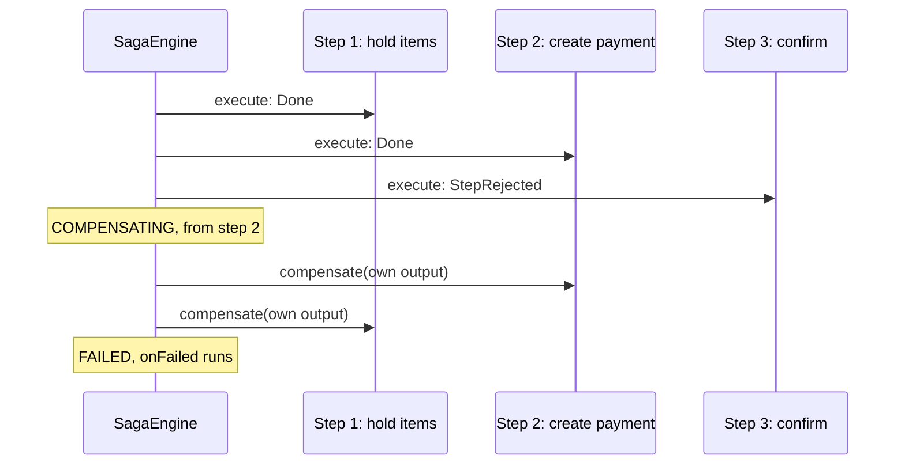

# Compensation

When a step is refused, the saga undoes what it already did: the **completed** steps, **last to first**, each with its own `compensate`.

## What starts a compensation

- A step throws `StepRejected`: nothing was applied by it, so it is not undone, only the steps before it.
- A signal is rejected by `onSignal`, or a timeout check finds nothing.
- A customer cancels (`cancel`), or an operator gives up (`abort`).

A refusal at the first step has nothing to undo: the saga ends `FAILED` at once.

The cause is kept in `failure_reason` (`SagaRecord.failureReason`), written when the compensation starts and never changed:

| Cause | `failure_reason` |
|---|---|
| A step or a signal refused | The refusal, as `StepRejected` describes it |
| A signal step timed out, and its check found nothing | `No signal '<name>' before the timeout, …` |
| `cancel(id, reason, actor)` | `Cancelled: <reason>` |
| `abort(id, actor, …)` | `Aborted by <actor>` |

Read it to tell a caller why a saga failed. `last_error` is the latest problem only: a compensation that fails and is retried overwrites it, so on a `FAILED` saga it may describe that failure instead.

## What a compensation receives

Its own step's output, as stored when the step completed: `compensate { own -> … }`. `own` is `null` when the step stored none, so write the undo to cope with it. When an operator aborts a step that is stuck but was applied (`abort(currentStepApplied = true)`), they give the output the compensation should receive.

## Steps with nothing to undo

A step declared without `compensate { … }`, and a signal step, which makes no call, have nothing to undo. Compensation passes over them at once: no call, no transaction of their own, one `NOTHING_TO_UNDO` entry in the history. A step written by hand says so with `compensates = false`; by default it is called.

## Undoing must be safe to repeat

A compensation runs again:

- after **any error**, with backoff (1, 2, 4… minutes, up to an hour), up to `maxAttempts`;
- after its **lock expired** (the pod died during it);
- after a manual `retry`.

So it must be written to be safe to run twice: "release the hold if it still exists", "refund unless already refunded", "delete if present". A compensation is never checked, since it has no unknown outcome to resolve: running it again is the check.

!!! note "Past maxAttempts"
    A compensation that keeps failing stops the saga (`TOO_MANY_ATTEMPTS`) in the `COMPENSATING` state. Once the cause is fixed, `retry` runs it again. If the undo was done by hand, or there was nothing to undo, `markCompensated(id, actor)` records it, and the saga goes on undoing the earlier steps.

## No isolation

Between the first step and the end of the compensation, other systems and users see the intermediate state: the items held, the payment created. A saga gives atomicity in the end, not isolation along the way. Rules that must not see the intermediate state need a business status of their own, such as an item's `SETTING_UP`, which the hooks change at the end.
