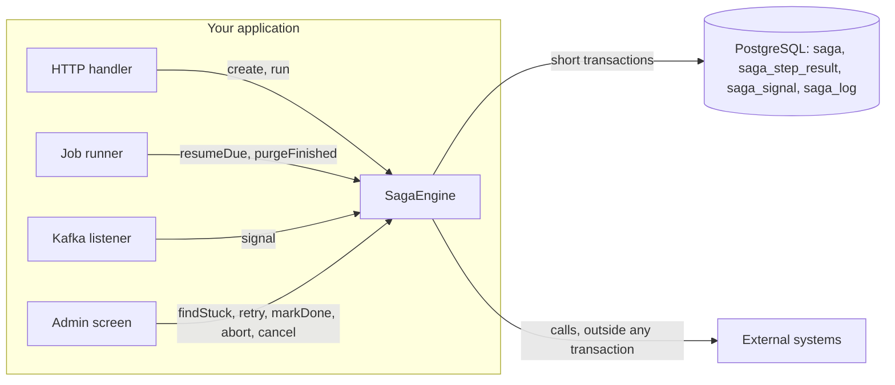

# How it works

The engine is a small state machine over one PostgreSQL row per saga. Everything it does comes from three rules:

1. **No external call inside a database transaction.** Each step is claimed in a short transaction, called with no transaction open, then recorded in another short transaction.
2. **An unknown outcome is checked, never replayed blindly.** After a timeout, the engine asks the external system whether the call was applied, unless the system accepts an idempotency key.
3. **When it cannot decide, it stops.** A saga that cannot tell whether a step was applied waits for a human instead of risking a duplicate.

| Page | What it explains |
|---|---|
| [Saga lifecycle](lifecycle.md) | The states of a saga and the statuses of its current step |
| [The step cycle](step-cycle.md) | Claim, call, record: transactions, locks and the time budget |
| [Unknown outcomes](unknown-outcomes.md) | The settle delay, checks, and replays with an idempotency key |
| [Compensation](compensation.md) | How completed steps are undone, and why undoing must be safe to repeat |
| [Signals and cancellation](signals.md) | Steps that wait for an event, and abandoning a saga |
| [Recovery and concurrency](recovery.md) | The recovery job, several pods, rolling deployments |
| [Saga data](saga-data.md) | Typed inputs and outputs, their storage, size and personal data |
| [Guarantees and limits](guarantees.md) | What the engine promises, and the cases to design around |
