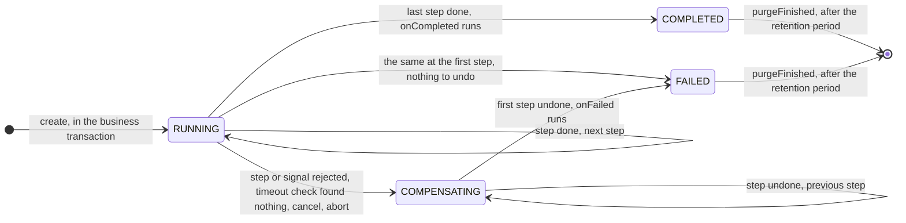
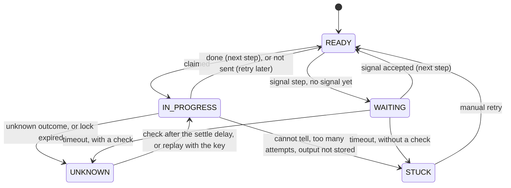

# Saga lifecycle

A saga has two levels of state: the **state** of the saga, which gives its direction or its end, and the **status** of its current step.

## Saga states

| State | Meaning |
|---|---|
| `RUNNING` | Executing steps forward |
| `COMPENSATING` | A step was refused, or the saga was cancelled or aborted: undoing the completed steps, last to first |
| `COMPLETED` | Every step is done. `onCompleted` ran |
| `FAILED` | Every completed step was undone. `onFailed` ran |

`RUNNING` and `COMPENSATING` are **unfinished**: the saga holds its business key (no other unfinished saga, of any type, may use it), and the recovery job picks it up whenever it is due. `COMPLETED` and `FAILED` are **final**: nothing changes them, and a new saga may start for the same key.

## Step statuses

| Status | Meaning |
|---|---|
| `READY` | Will be called (or undone) at `next_attempt_at` |
| `IN_PROGRESS` | A call is in flight, protected by a lock until `locked_until` |
| `WAITING` | A signal step waits for its event, until its timeout at `next_attempt_at`. No call is in flight |
| `UNKNOWN` | The last call's outcome is unknown: it may have been applied. A check is scheduled, or a replay for an idempotent step |
| `STUCK` | A human must decide. `stuck_reason` says why |

## Who moves a saga

| Who | Calls | When |
|---|---|---|
| The request that starts it | `create`, then `run` | At once, within a time budget |
| The recovery job | `resumeDue` | Every 30 s or so: whatever is due |
| A listener | `signal` | When an awaited event arrives |
| An operator, or the customer | `retry`, `markDone`, `abort`, `markCompensated`, `cancel` | When a saga is stuck, or must be abandoned |

Each of them goes through the same row lock, so they never act on a saga at the same time. Every change they make is written to `saga_log`.
