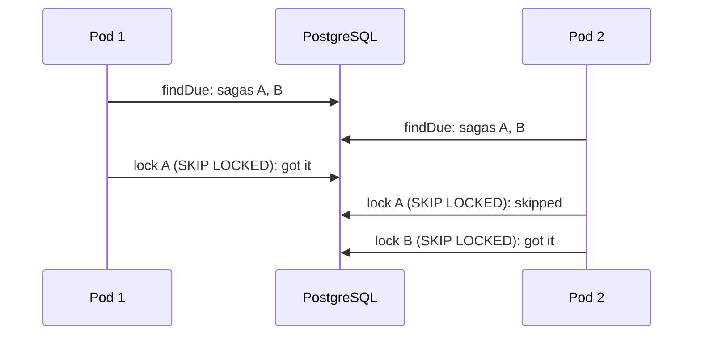

# Recovery and concurrency

A saga is moved by whoever claims its row: the request that started it, the recovery job on any pod, a listener, an operator. This page is how they share the work safely.

## The recovery job

```kotlin
val result = engine.resumeDue(limit = 50, budgetPerSaga = 20.seconds, concurrency = 8)
```

Call it every 30 seconds or so. Each call:

1. **Finds due sagas:** unfinished, not stuck, `next_attempt_at` passed, of a type this engine knows. A partial index (`saga_due`) keeps this one quick read, whatever the number of finished sagas.
2. **Runs them**, up to `concurrency` at the same time, each within `budgetPerSaga`. A slow external system holds up only its own sagas.
3. **Reports failures** without stopping: a saga whose run throws (a database error, a bug, data it cannot read) is returned in `result.failures`, and postponed by `resumeFailureDelay` (logged as `RESUME_FAILED`), so that sagas failing every time cannot fill each batch.

"Due" covers every reason a saga needs attention: a retry after backoff, an outcome to check, a lock that expired (the pod died), a signal's timeout.

## Several pods at once

Every claim locks the saga's row. The recovery job uses `FOR UPDATE SKIP LOCKED`: a row another pod is working on is simply skipped, and each saga is run by one pod at a time. The request that started a saga and a recovery job never run it together either: the second one finds the step `IN_PROGRESS` with a valid lock, and leaves it.



Rows are locked one at a time, for the length of a short transaction, never during a call.

!!! tip "Spread the pods' runs over the period"
    Pods that call `resumeDue` at the same instant read the same oldest due sagas: one pod takes each saga, and the others spend a short transaction each finding it taken. That costs little in normal times, but during a backlog (hundreds of sagas due after an outage), synchronized pods work on the same batch, and adding pods does not speed up the catch-up. A pod that runs a moment later does not see the sagas already claimed, and takes the next ones.

    So start each pod's job at a random offset within the period, rather than on the clock (every 30 seconds on the half-minute, as many schedulers do):

    ```kotlin
    launch {
        delay(Random.nextLong(30_000))                    // a random start offset, once per pod
        while (isActive) {
            engine.resumeDue()
            delay(30.seconds)
        }
    }
    ```

## Rolling deployments

`resumeDue` only picks up the saga types its engine knows. During a rolling deployment, pods still on the old version leave a new saga type to the new pods. A saga type that is removed leaves its unfinished sagas untouched: finish or migrate them first.

The data a saga stores must stay readable by both versions while they run side by side: see [Saga data](saga-data.md). A pod that cannot read a saga's data postpones it, with nothing called, so that a version that can read it picks it up.

## Clocks

Locks are compared with times written by other pods, so the pods' clocks must agree (NTP). A drift of a few seconds is harmless next to a 35-second `callLock`.

## Connections

A saga holds a connection only during its short transactions. `resumeDue` may hold up to `concurrency` of them at once. Keep it well below the connection pool size, leaving room for the application's own requests.
