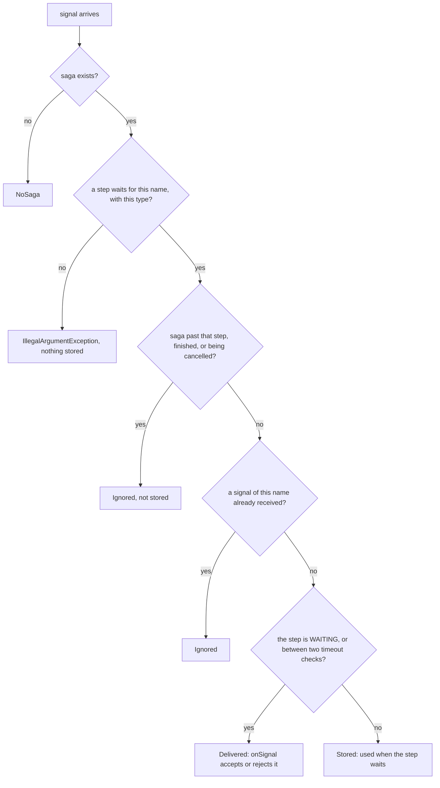

# Signals and cancellation

## Steps that wait for an event

A signal step makes no call: it waits for an event that something else delivers, a payment confirmed on Kafka for example. Its value becomes the step's output.

```kotlin
val paid = awaitSignal<PaymentResult>("await-payment", signal = "payment", timeout = 30.minutes) {
    onSignal { if (!it.succeeded) throw StepRejected("payment failed") }   // optional: accept or reject
    check { payments.status(requireResult(payment).id) }                    // optional: decides at the timeout
    logAs { it.paymentId }
}
```

- **`signal`** names the event, not the step. A name is used by one step of a saga, checked at startup.
- **`onSignal`** runs inside the engine's transaction, whether the value comes from a signal or from the timeout check: it decides, it does not call anything. Throwing `StepRejected` makes the saga compensate. Anything else it throws is a bug: the transaction rolls back whole, then the signal is stored and the saga stops (`RECORD_FAILED`). `engine.signal` answers `Stored`, so a listener does not redeliver the event for ever. Once the bug is fixed, `retry` uses the signal kept. The same holds when the signal ends the saga and its `onCompleted` or `onFailed` hook throws.
- **While it waits**, the saga is a row with status `WAITING` and `next_attempt_at` set to the timeout. No thread, connection or lock is held.

### Delivering a signal

`engine.signal(sagaId, name, value)` is one short transaction. It locks the saga's row, finds the step of its definition that waits for `name`, checks the value's type against the one the step declares, then:



**Only the first signal of a name counts.** It is stored in `saga_signal`, whose primary key is the saga and the signal name, so a redelivered event changes nothing. That is what makes a Kafka listener simple: deliver, then commit the offset.

**A signal can arrive before its step waits.** The provider's event may be faster than the HTTP request that started the saga. It is stored, and used the moment the step would start waiting: the saga goes straight on.

**Routing is by saga id.** The external system must carry our saga id, as a payment's reference for example. A system that only returns its own ids would need a correlation table, which the engine does not have.

### The timeout

At the timeout, the recovery job claims the step (`WAIT_TIMED_OUT` in the history):

| The step has | What happens |
|---|---|
| A check that finds a value | It is accepted, through `onSignal` like a signal |
| A check that finds nothing | The saga compensates |
| A check that cannot tell | The saga stops (`CANNOT_TELL`) |
| No check | The saga stops (`NO_SIGNAL`). A human delivers the event by hand, then `retry` waits again |

**A signal received after the timeout still counts**, until the saga moves on. The timeout is a fallback for an event that may be lost, not a deadline:

- A signal that arrives while the check runs is stored. If the check finds a value, that value is used: it is the same event. If it finds nothing or cannot tell, the stored signal is used instead: the lookup ran just before the event, which did happen. If the check fails (it throws), it is not tried again: the stored signal is used.
- A check that failed is retried later, with backoff. A signal that arrives before that retry is delivered at once, as to a waiting step.

Either way the signal goes through `onSignal`, like any other. **A business deadline belongs there**: to refuse a payment that comes too late, compare its time with the deadline in `onSignal` and throw `StepRejected`.

## Cancellation

`engine.cancel(sagaId, reason, actor)` abandons a saga: everything done so far is compensated.

| The saga | What happens |
|---|---|
| Waits for a signal, or is ready | Compensates at once |
| Has a call in flight, or an outcome still unknown | Compensates as soon as that outcome is recorded, the call included if it was applied |
| Is stuck | Stays stuck: the cancellation is applied when a human retries or marks it done |
| Is already compensating | Nothing more to do. The request is logged, marked `already compensating: nothing changed`, and `failure_reason` keeps the original cause |
| Is finished | Refused: undoing a completed saga is a new saga |

The first cancellation counts: its time and reason stay on the row (`cancel_requested_at`, `cancel_reason`), and nothing overwrites them. Who cancelled is in the history (`CANCEL_REQUESTED`). A cancellation that waited and takes effect later is logged as `CANCELLED`.

A cancellation that is pending also makes the saga **ignore its signals**: whatever the outcome of the call in flight, it will compensate and never wait again.
