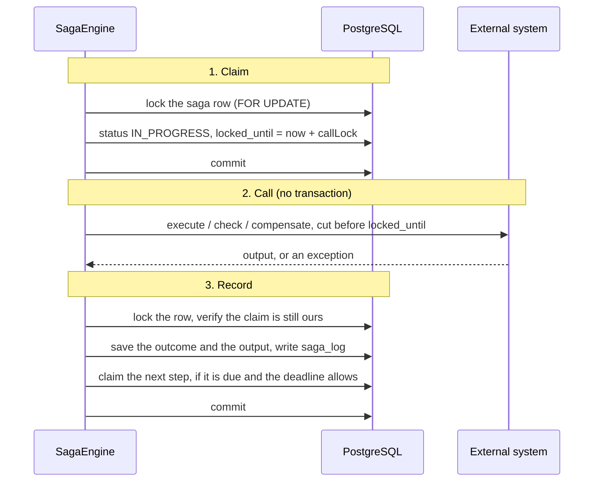

# The step cycle

Every step goes through the same three phases. Only the first and the last touch the database, each in its own short transaction. The call itself runs with **no transaction open**, so a slow external system never holds a connection or a row lock.

## 1. Claim

The claim locks the saga's row, decides what to do, and marks the step `IN_PROGRESS` with a lock: `locked_until = now + callLock` (35 s by default). What to do depends on the step's status:

| Status | Action |
|---|---|
| `READY`, saga `RUNNING` | **execute** the step |
| `READY`, saga `COMPENSATING` | **compensate** it |
| `UNKNOWN` | **check** it, or **replay** it if the step is idempotent |
| `READY`, signal step | no call: start **waiting**, or use a signal already received |

Before anything is called, the claim also decodes the saga's data: data that cannot be read stops here, with nothing called.

## 2. Call

The call runs outside any transaction, and is **cut shortly before its lock expires**: at `locked_until` minus a margin (a tenth of `callLock`, at most 5 s). The margin leaves time to record the outcome while the claim is still valid. Without it, a call that outlived its lock could land after another pod had already checked the step, or rerun a compensation alongside it.

A call that is cut counts as an **unknown outcome**: it may have reached the external system.

!!! warning "Calls must be cancellable"
    Cutting a call cancels its coroutine, which only stops code that suspends. A blocking call (a JDBC query, `HttpClient.send`, `Thread.sleep`) runs to its end, and can outlive its lock. Use a suspending client (Ktor's, for example), wrap blocking code in `runInterruptible`, and give every client its own timeout below `callLock`.

## 3. Record

The record locks the row again and checks that the claim is still ours: the step is still `IN_PROGRESS`, at the same index, with the same `locked_until`. If another pod took over after the lock expired, the outcome is dropped and logged as `LATE_RESULT_IGNORED`.

It then saves the outcome, the output if there is one, and a `saga_log` entry, and decides what comes next. While the row is locked, it also **claims the next step** if it is due and the caller's deadline has not passed: one transaction instead of two. A two-step saga takes about 4 commits in all, including its creation.

When the saga ends, its `onCompleted` or `onFailed` does not run in this transaction: the saga is `FINISHING`, and the hook runs next, in a transaction of its own that also ends it, so the business state and the saga's state still change together (see [the hooks](lifecycle.md#the-hooks)). A saga without the hook ends here.

### When recording fails

If the record transaction rolls back (a constraint, the database), the call's outcome must not be lost. No user code runs here: a value a check found is stored, and `onSignal` runs on it in the next claim. Hooks never run here: they run once the outcome is committed, on their own (see [the hooks](lifecycle.md#the-hooks)).

1. The engine records the outcome again, alone, without claiming the next step.
2. If that fails too, the saga becomes `STUCK` (`RECORD_FAILED`) on the step that ran. What the outcome established is kept, and `last_error` says what follows, once the cause is fixed:
    - **a success:** its output is saved with the step's result, and `markDone(id, null, actor)` continues with it;
    - **an undo:** the step is marked undone, and `markCompensated(id, actor)` goes on without undoing it again;
    - **a refusal:** nothing was applied. The refusal is kept as the saga's `failure_reason`: `abort(id, actor, currentStepApplied = false)` gives up with it as the reason, and `markDone` is refused, since it would turn the refusal into a success.

## The time budget

`run(id, deadline)` loops through cycles until the saga ends, blocks (a retry later, an outcome to check, a wait, a human), or the deadline passes. The deadline is checked **between** calls, not during them: an HTTP request can wait up to its deadline plus one call, at most `callLock`.

When the deadline passes, nothing is lost: the saga is left `READY` (or `UNKNOWN`, `WAITING`) with its `next_attempt_at`, and the recovery job continues it.

## The crash case

If the pod dies during the call, the row stays `IN_PROGRESS` until `locked_until`. The next claim after that, by any pod, sees an expired lock:

- **Forward**, the call may have been applied: the step becomes `UNKNOWN` and is checked after the settle delay. An idempotent step is replayed at once with its key. If it was a check that the pod was running, it counts as a failed check, up to `maxAttempts`.
- **During a compensation**, the compensation simply runs again: compensations are safe to repeat.

Logged as `LOCK_EXPIRED`. The [next page](unknown-outcomes.md) explains what happens to an unknown outcome.
