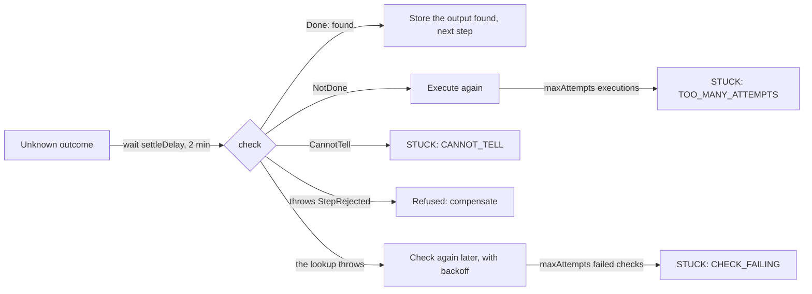

# Unknown outcomes

A call times out. Was it applied? The external system may have done the work and lost the response, or never received the request. Calling again risks a duplicate (two stock entries, two charges); giving up risks leaving an effect nobody undoes. This page is how the engine decides.

## What counts as unknown

Any exception from `execute` other than `StepRejected` and `StepNotSent`: a read timeout, a connection reset, a `5xx`, a call cut at its lock, even a JVM `Error` such as a `TODO()` left in a client. A pod that dies mid-call is unknown too. Only fatal JVM errors (out of memory, stack overflow) escape.

## The check

A step's `check` answers "was I applied?" with a **read** in the external system: `Done(output)` (found: it becomes the step's output, as if the call had returned it), `NotDone`, or `CannotTell`. When the external system keeps a record of refused attempts and finds ours refused, the check throws `StepRejected`, as `execute` would have: the saga compensates, without calling the step again. Any other exception means the lookup itself failed: it is tried again. `checkByLookup` builds one from a search: no match means not done, one means done, several means the engine cannot tell which is ours.

### Why wait first

A request that timed out on our side may still be **in progress** on the other side. Checking at once could find nothing, run the step again, and then the first request lands too: a duplicate. So the check waits for `settleDelay` (2 minutes by default). Set it above the longest time the external system may spend on a request.

### When the lookup itself fails

Failed checks are counted apart from executions, so a lookup outage does not use up a step's attempts. They are retried with backoff, at least `checkRetryDelay` (1 minute) apart. A check whose lock expires before it records an outcome (its pod died) counts as a failed one. After `maxAttempts` failures in a row, the saga stops (`CHECK_FAILING`), like a check that cannot tell. The call may have been applied, so a human must look before retrying.

### Without a check

A step without `check` answers `CannotTell`: every unknown outcome stops the saga for a human. That is safe, but it turns each timeout into manual work. Offer a lookup wherever the external system allows one.

## Replays with an idempotency key

A step marked `idempotent(keyRetention)` sends a key the engine gives it, and its service answers a repeated request with its first result. For such a step, an unknown outcome is **replayed** with the same key instead of checked:

| | Step with a check | Idempotent step |
|---|---|---|
| After an unknown outcome | `check` after `settleDelay` | Replay after backoff (1, 2, 4… min) |
| After a lock expiry | `check` after `settleDelay` | Replay at once |
| Until the outcome is known | `CHECKING` | `REPLAYING`: a replay that is not sent keeps it so |
| Limit | `maxAttempts` executions | `maxAttempts` attempts, and the key's window |

While the step is `CHECKING` or `REPLAYING`, it may have been applied: `abort` is refused and `cancel` waits for the answer. The engine never sends a key its service may have forgotten: past `keyRetention`, the saga stops with `KEY_EXPIRED`. See [Services with idempotency keys](../use-cases/idempotent-services.md).

## What it costs

An unknown outcome takes at least `settleDelay` to resolve, and the caller gets a `202` meanwhile. The rare cases where a duplicate can still happen are listed in [Guarantees and limits](guarantees.md).
