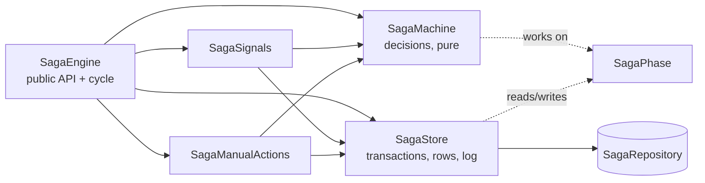
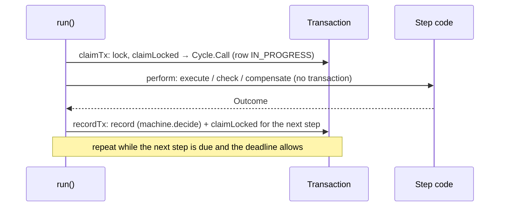
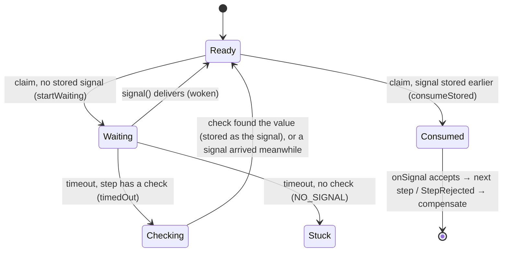

# Engine internals

The [How it works](../how-it-works/index.md) pages describe what the engine does. This page describes **how the code does it**, for whoever works on `akta-core`: which file owns what, how a step goes through the code, and where each kind of failure is handled. It names functions rather than line numbers. Open the files next to it.

## The files

| File | What it owns |
|---|---|
| `SagaDsl.kt` | `saga { }`, `step { }`, `awaitSignal { }`: builders that produce a `SagaDefinition` |
| `Saga.kt` | The public model: `SagaDefinition`, `SagaStep`, `SignalStep`, `SagaContext`, `StepRejected`, `StepNotSent`, `CheckResult` |
| `SagaEngine.kt` | The public API, and the cycle of each step: claim, call, record, finish |
| `SagaMachine.kt` | **Every decision**, as pure functions: a `SagaPhase` in, the `SagaPhase` it becomes out |
| `SagaPhase.kt` | A saga's row, typed: only the combinations the engine may write can be built |
| `SagaStore.kt` | Transactions, the row read as a phase and saved back, the log, listener events |
| `SagaSignals.kt` | Signals: delivered by `signal()`, consumed through `onSignal` when the saga runs |
| `SagaManualActions.kt` | `retry`, `markDone`, `abort`, `markCompensated`, `cancel` |
| `SagaData.kt` | Small shared helpers: erased type aliases, decoding stored data, `describe`, `isFatal` |
| `SagaRepository.kt`, `SagaModel.kt` | The storage interface and the stored types (`SagaRecord`, `StepStatus`, `StuckReason`…) |

The central split is between **deciding and doing**. `SagaMachine` decides: it has no store, no clock, no serializer, and never runs step code, so it is tested on its own (`SagaMachineTest`). Everything else does: it reads the row, calls the step, writes what the machine decided.



## 1. Defining a saga: `SagaDsl.kt`

```kotlin
val reserve = saga<Order>("reserve") {
    val hold = step<HoldId>("hold-stock") {
        execute { stock.hold(input.items) }
        compensate { stock.release(it) }
    }
    awaitSignal<Payment>("payment", signal = "paid", timeout = 15.minutes) {
        onSignal { if (it.amount != input.total) throw StepRejected("wrong amount") }
    }
    onFailed { notify(input.customer) }
}
```

- **`saga<I>()` / `step<O>()` / `awaitSignal<S>()` are `inline` with `reified` types.** They capture `typeOf<O>()` so the engine can serialize each value with its real type. Each one hands off to a non-inline `@PublishedApi internal` function (`addStep`, `addSignalStep`), which keeps the body of the inlined code small and the builder's internals private. `Unit` means "no value": `unlessUnit()` turns it into a null type, and nothing is stored.
- **`step(name) { }` without a type argument** is a separate overload with `@JvmName("stepWithoutOutput")`. Erased, both overloads would have the same JVM signature.
- **`declared` + `once(...)`** refuse a block declared twice (`onCompleted`, `execute`, `onSignal`…). Without it, the second declaration would silently replace the first.
- **`@SagaDslMarker`** stops a `step { }` block from calling the outer `SagaBuilder` by accident.
- `SagaDefinition`'s `init` (in `Saga.kt`) checks the whole definition: unique step names, unique signal names, name lengths.

A definition is only data. The engine is given the list of definitions and keeps them by `type`.

## 2. The typed row: `SagaPhase.kt`

`SagaRecord` is the row as stored: about 25 columns, many nullable. Most combinations are wrong, for example a lock without a call in flight, a stuck step without a reason, or a completed saga with a failure reason. `SagaPhase` makes them impossible to build. It has two levels:

```
SagaPhase                       where the saga is
├── Unfinished                  has a current step: step: StepState
│   ├── Running                 executing forward
│   ├── Compensating            undoing, last to first      (failureReason required)
│   └── Finishing               only its hook left to run   (ending: COMPLETED or FAILED)
└── Finished                    COMPLETED or FAILED         (no step at all)

StepState                       where the current step is, each with due (= nextAttemptAt)
├── Ready      run / undo / start waiting, from due
├── Waiting    signal step, until due (its timeout)
├── Checking   outcome unknown: check() at due
├── Replaying  outcome unknown, idempotent step: replay with the same key at due
├── InFlight   a call running: call (EXECUTE / CHECK / COMPENSATE) + lockedUntil
└── Stuck      waiting for a human: reason, at, from
```

- **`SagaPhase.of(record)`** reads a row and checks every rule (`rule(...)`, each with a message naming it). `SagaStore.lock` calls it, so every saga the engine acts on was validated when it was read.
- **`record()`** writes the phase back: a default row, then each phase sets what it owns. `withStep` spreads a `StepState` over its columns.
- **`Unfinished.with(...)`** is a `copy` on the interface, so the machine can write `r.with(step = StepState.Ready(now))` without knowing whether the saga runs or compensates.
- **`failureReason == null` means success**, for `Finishing.ending` and `Finished.state` alike.
- `Running.refusal` is the one odd field. It holds a `StepRejected` that could not be recorded (`RECORD_FAILED`), kept so that `markDone` refuses the saga and `abort` keeps the refusal as the reason.

Signatures in `SagaMachine` lean on these types. `stuck(r: Unfinished, …)` cannot receive a finished saga, and `Move.Finish` carries a `Finishing`.

## 3. Creating and running: `SagaEngine.create` / `SagaEngine.run`

### `create`

`create` runs **inside the caller's business transaction**. It is the transactional outbox: the business change and the saga commit together, or neither does. It checks that the definition is registered, that the key isn't blank and that the encoded input fits `maxDataBytes`, then builds `machine.created(...)` and inserts it. `DuplicateSagaException` means an unfinished saga already holds the key (one per key, across all types). It runs no step.

### `run(id, deadline)`

`run` moves one saga forward until it rests (finished, stuck, waiting, not due) or the deadline passes. It is a flat loop over a sealed `Cycle`:

```kotlin
var cycle = claimTx(id, …)                 // transaction 1
while (true) {
    cycle = when (val current = cycle) {
        is Cycle.Rest       -> break
        is Cycle.Call       -> recordTx(current.work, perform(current.work), claimUntil)   // call, then transaction 2
        is Cycle.Finish     -> finish(id, trace)          // the hook, in its own transaction
        is Cycle.ClaimAgain -> claimTx(id, …)             // a stored signal, in its own transaction
    }
}
```



- **Every transaction and call runs `NonCancellable`.** Once a claim commits, its call and record must follow, even if the HTTP client goes away. The caller's cancellation only stops the next claim (`claimUntil = deadline.takeIf { caller.isActive }`), and `run` rethrows it at the end.
- **`recordTx` records and claims the next step in one transaction**, so one step costs two transactions, not three.
- **`claimLocked`** is one `while` loop. It asks `machine.move(saga, now)` for changes that need no call (an expired lock, a cancellation, a step with nothing to undo, a signal timeout), saves and logs each one, and asks again. It stops on `Move.Rest`, `Move.Finish` or `Move.NoSignal`, or once `Move.Act` leads to a claimed call (`machine.claim` gives `Claim.Call` or `Claim.KeyExpired`). The step's data is decoded (`context(...)`) before any call, so unreadable data rolls the claim back with nothing called.
- **`perform`** is the only place with no transaction open. It cuts the call at `lockedUntil - recordMargin`, so the outcome is recorded while the lock is still ours.

## 4. Deciding: `SagaMachine.decide`

`perform` first turns what the step did into an `Outcome` (`SagaEngine.call` / `failure`). So `decide` never sees an exception:

| Action | Step result | Outcome |
|---|---|---|
| EXECUTE | value | `Done` (or `OutputUnstorable`: too large, cannot encode) |
| | `StepRejected` | `Rejected` |
| | `StepNotSent` | `NotSent` |
| | anything else | `Unknown` |
| CHECK | `CheckResult.Done` / `NotDone` / `CannotTell` | `Done` (`Found` for a signal step) / `NotDone` / `CannotTell` |
| | `StepRejected` / anything else | `Rejected` / `CheckFailed` |
| COMPENSATE | returns / throws | `Compensated` / `CompensationFailed` |
| any | no time left before the lock expires | `NotCalled` |

`SagaEngine.record` locks the row again. It checks `machine.stillClaimed(current, work.saga)`: is this still our call? If not, it logs `LATE_RESULT_IGNORED` and changes nothing. Otherwise it calls:

```kotlin
machine.decide(claimed, outcome, replay, unclaimed, now, signalStored): Decision(saga, effects)
```

`decide` releases the lock and maps the outcome:

| Outcome | Becomes | Why |
|---|---|---|
| `Done` | `SaveResult` + `next()`: next step, `Finishing` (hook) or `Finished` | `next` compensates instead if a cancel is pending |
| `Rejected` | `refused()`: compensate from `i - 1` | the refused step applied nothing |
| `NotSent` | `retryLater` (key window reset); on a replay: still `Replaying` | definitely not applied |
| `Unknown` | `Checking(now + settleDelay)`; idempotent: `replayLater` | maybe applied, never retried blindly |
| `NotDone` | `Ready(now)`, or `Stuck(TOO_MANY_ATTEMPTS)` | the check says not applied |
| `CheckFailed` | `Checking` with backoff, counted in `checkFailures`; then `Stuck(CHECK_FAILING)` | a lookup outage must not use up executions |
| `CannotTell` | `Stuck(CANNOT_TELL)` | only a human can tell |
| `OutputUnstorable` | `Stuck(OUTPUT_UNSTORABLE)` | called, but the result cannot be kept |
| `Compensated` | `MarkCompensated` + `previousUndo()` | below step 0: `Finishing` (onFailed) or `FAILED` |
| `CompensationFailed` | `retryLater` | undos are meant to be safe to repeat |
| `NotCalled` | back to the state it was claimed from (`unclaimed`), no attempt used | nothing happened |

The block at the top handles a signal step's timeout check (see [Signals](#6-signals-sagasignalskt)). `Effect`s (`SaveResult`, `SaveSignal`, `MarkCompensated`) are what the decision writes besides the row. `SagaStore.write` applies them.

## 5. Failure handling

Step errors are outcomes. This section is about the engine's own failures: timeouts, crashes, the database, bugs.

| What breaks | Where it is handled | What happens |
|---|---|---|
| The call runs too long | `perform` (`withTimeout(budget)`) | a failed call: `Unknown` for an execute |
| No time left after the claim (GC pause) | `perform` | `NotCalled`: the claim is undone |
| The caller is cancelled | `run` (`NonCancellable`) | the claimed call and its record still happen |
| The pod dies mid-call | `machine.move` → `lockExpired` | forward: `Checking` (or `Replaying` if idempotent); undo: run again. Times are computed from `lockedUntil` |
| The result arrives after another pod took over | `record` (`stillClaimed`) | `LATE_RESULT_IGNORED` |
| Recording + next claim fails | `recordTx` → `recordAfterFailure` | the outcome is recorded alone, in a new transaction |
| Recording alone fails too | `recordFailed` → `machine.recordFailed` | `Stuck(RECORD_FAILED)`, keeping what the outcome established, with the next action in `lastError` |
| `run` throws (database, unknown type, unreadable data, a bug) | `resumeDue` / `manual` → `postpone` → `machine.postpone` | postponed by `resumeFailureDelay`; after `maxAttempts`: `Stuck(RESUME_FAILING, from = …)` |
| A hook throws | `finish` → `hookFailedLocked` → `machine.hookFailed` | retried with backoff; then `Stuck(HOOK_FAILED)`. The steps' work is already committed |

The rule underneath: **the engine never guesses whether a call was applied.** It retries what is known not to have been applied, checks or replays what is unknown, and stops for a human otherwise. `stuck()` always writes in `lastError` what to do next.

`resumeDue` catches each saga's failure separately: one failing saga never cancels the others in the batch, and the error goes into `ResumeResult.failures`. Only `VirtualMachineError` (`isFatal`) and cancellation escape.

## 6. Signals: `SagaSignals.kt`

The design is **store and wake**: `signal()` only stores the signal and wakes the saga. `onSignal` runs later, inside a claim.



- **`deliver`**, in the `signal()` transaction:
  1. Validate the name, the type and the size.
  2. `machine.arrival`: `TOO_LATE` and `CANCELLED` are not stored.
  3. `saveSignal`: the first signal of a name wins, and redeliveries are `Ignored`.
  4. `machine.useOfStored`: `WAKE` if the step is listening (it becomes `Ready(now)`), else `KEEP` for later. That second case is how early signals work.

  No user code runs, so a Kafka consumer or webhook handler never fails because of a bug in `onSignal`.
- **Consumption happens in `claimLocked`.** A `Ready` or `Checking` signal step looks for a stored signal first, because it answers what the check would look up. If the same transaction already recorded something (`afterChange`), it returns `Cycle.ClaimAgain` instead, so that `onSignal` throwing cannot roll back that record.
- **`onSignal` throwing anything but `StepRejected`** is a bug. It becomes `SignalFailed`, the claim rolls back, and `claimTx` opens a second transaction: `blockOnStoredSignal` → `Stuck(RECORD_FAILED)`. The signal is kept, so `retry` uses it after the fix.
- **The timeout check** is an ordinary `CHECK` call. A value it finds becomes `Outcome.Found` → `SaveSignal`, and goes through `onSignal` at the next claim, like a delivered one. If a real signal arrived during the check and the check found nothing or failed, the signal wins (the top of `decide`).

## 7. Manual actions: `SagaManualActions.kt`

Every action goes through `manual()`:

```
① transaction:  lock → change(r, now) → save → log(event, detail, actor) → commit
② then:         if runFor > 0 and machine.canMoveOn → runOn(id, now + runFor)
                   └─ throws → postpone, and the action still returns the saga as committed
```

`SagaMachine` checks that the saga can take the action (each `require` throws `IllegalArgumentException`) and gives the transition. `SagaManualActions` decodes and saves outputs.

| Action | Allowed on | Becomes |
|---|---|---|
| `retry(newKey)` | a stuck saga (`KEY_EXPIRED` needs `newKey`) | `Replaying` for an idempotent step whose key was used; after `RESUME_FAILING`, back as it was (`resumeAs`); else `Ready(now)`, which **executes again without checking** |
| `markDone(output)` | a stuck forward step with no kept refusal | output checked (`manualOutput`) and saved, then `next()`. On a signal step: stored as the signal, and `onSignal` still decides (`signalByHand`) |
| `abort(currentStepApplied, output)` | running, not in flight or unknown; or a stuck `onCompleted` | compensate from `i` (applied, with its output saved) or `i - 1` |
| `markCompensated` | a stuck compensation | `MarkCompensated` + `previousUndo()` |
| `cancel(reason)` | any unfinished saga except `Finishing` | compensate now if no call is in flight; otherwise `record` applies it once the outcome is in |

`cancel` is a business request rather than a repair. It lives here because it follows the same commit-then-run path.

## 8. The store: `SagaStore.kt`

- **`tx { }`** wraps `SagaTransactions.inTransaction`. It keeps a `Pending` in a `ThreadLocal`, which is safe because the block is plain blocking code. Listener events are emitted only after commit.
- **`save` is buffered.** A saga changed several times in one transaction (recorded, then its next step claimed) is written once at the end: one `UPDATE`, one dead row version. `flush()` writes early, before a hook that may read the table.
- **`lock`** returns a validated `SagaPhase`. **`write(effects)`** applies a decision's effects. **`log`** writes `saga_log` and queues the listener event.
- **`storable()`** replaces `U+0000`, which PostgreSQL refuses. A text the database refuses would otherwise block the very record that describes it.

## Where to start for a change

| You want to… | Look at |
|---|---|
| change what an outcome leads to | `SagaMachine.decide` (+ `SagaMachineTest`) |
| change what happens without a call (expiry, cancel, nothing to undo) | `SagaMachine.move`, then `SagaEngine.claimLocked` |
| add a stored field or a rule on the row | `SagaPhase` (`of`, `record`), `SagaRecord`, the schema |
| add a manual action | `SagaMachine` (guard + transition), `SagaManualActions` (via `manual()`), `SagaEngine` (public API) |
| change signal delivery | `SagaSignals.deliver`, `SagaMachine.arrival` / `useOfStored` |
| touch transactions or the order of writes | `SagaEngine.claimTx` / `recordTx`, `SagaStore` |

Run `./gradlew test`, `:akta-exposed:stressTest` (PostgreSQL in Testcontainers) and `:akta-core:check` (`explicitApi`) before a commit.
